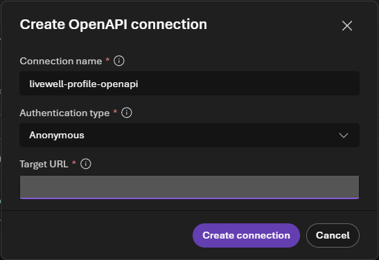

# ADMIN-SETUP — facilitator runbook (T-10 → T+1)

> **Reference material from the earlier 6-person sponsor delivery.** The HPB MCAPS delivery (30 participants, one
> resource group, current models) is run from the [HPB delivery runbook](HPB-DELIVERY-RUNBOOK.md); where this page
> differs, the runbook wins. In particular, do **not** follow this page for: quota numbers (400K / 200K TPM were
> sized for 6 people), the cost table and budget (US$150 / US$300), ad-hoc Search region overrides (Search now uses
> the approved `environments.<env>.search_location`), a `northcentralus` fallback, participant evaluations or red teaming (Lab 2 is look-only), passwords and
> Authenticator (participants sign in with a Temporary Access Pass), turning security defaults off, or purging
> soft-deleted accounts (separate approval). `scripts/preflight.sh` and `scripts/provision.sh` now also refuse to
> run against the wrong subscription and do not deploy without `--yes`.

Everything a facilitator runs to stand up, operate and tear down one LiveWell Coach workshop environment.
The resources, names and costs come from [SPEC.md](../../SPEC.md) §8, §12.1 and §13. The one config file is
[workshop.yaml](../config/workshop.yaml). The sponsored-tenant variant is in [TENANT-BOOTSTRAP.md](TENANT-BOOTSTRAP.md).

- [Who needs what](#who-needs-what)
- [Timeline](#timeline)
- [Cost table](#cost-table)
- [What not to leave running](#what-not-to-leave-running)
- [RBAC model and gotchas](#rbac-model-and-gotchas)
- [Backup plans](#backup-plans)
- [Troubleshooting provisioning](#troubleshooting-provisioning)
- [Script reference](#script-reference)

## Who needs what

| Who | Needs | Why |
|---|---|---|
| Facilitator (runs the scripts) | **Owner** on the subscription (or Contributor + User Access Administrator) | The template creates role assignments |
| Facilitator | **Fabric Administrator** (Entra role) and a Fabric licence (Free is enough; sign in once at app.fabric.microsoft.com) | Tenant settings, capacity admin, `scripts/fabric/deploy.sh` |
| Facilitator | Listed in `environments.<env>.facilitator_upns` in `workshop.yaml` (the bicepparam reads it) | Capacity admin in the Fabric admin portal |
| Whoever creates lab accounts | **User Administrator** (Privileged Role Administrator for the break-glass role) | [create-lab-users.sh](../../scripts/tenant/create-lab-users.sh) |
| Attendee | Nothing up front: [seed-attendees.sh](../../scripts/seed-attendees.sh) grants it | See [RBAC model](#rbac-model-and-gotchas) |

Tools: Azure CLI, Azure Developer CLI **1.34 or later** (`azd version`), Python 3.11+ with
`pip install -r requirements.txt`, Fabric CLI (`pip install ms-fabric-cli`, Phase 3), and bash. The Codespace
has all of them. On Windows, use Git Bash (`bash scripts/preflight.sh mcaps`).

Sign in once per shell:

```bash
az login --tenant <tenant-id>             # tenant ID: workshop.yaml environments.<env>.tenant_id
azd auth login --tenant-id <tenant-id>
fab auth login                            # Phase 3 onwards
```

**Checking an existing MCAPS setup is not provisioning it.** Compare the subscription explicitly with
`environments.mcaps.subscription_id` in [workshop.yaml](../config/workshop.yaml), not just the friendly name
`mcaps` or the CLI's global default. The current MCAPS deployment uses `aif-hpb-livewell-mcaps`,
`srch-hpb-livewell-mcaps` and `fabhpblivewellmcaps`; per-environment name overrides leave sponsor unchanged.
Its existing Search service is in France Central (the capacity exception in ASSUMPTIONS.md 2.5); Foundry
and Fabric remain in Sweden Central. To regenerate only the local parameter file:

```bash
azd env select mcaps
AZURE_ENV_NAME=mcaps python scripts/select-params.py --parameters-only
```

This does not create users, assign roles, generate a token, provision resources or resume capacity.
Account creation remains a separate operator task. Restoring deployment outputs does not restore the
private DevUI token; restore that value privately before a later provision, rather than generating a replacement.

## Timeline

### T-10: quota requests

```bash
azd env new mcaps --subscription <subscription-id> --location swedencentral   # once per environment
bash scripts/preflight.sh mcaps
```

For every FAIL, preflight prints the quota-request link. Typical asks on a fresh subscription:

| Quota | Needed | Where |
|---|---|---|
| Fabric capacity units in `swedencentral` | 2 CU for F2, 4 CU for F4 (`FABRIC_SKU`) | Azure portal → Quotas → Microsoft Fabric |
| `gpt-5-mini` Global Standard | 400K TPM (Labs 0–2, Lab 3 specialists, memory store, KB planner, Lab 4) | Foundry portal → Management center → Quota |
| `gpt-4.1-mini` Global Standard | 200K TPM (Lab 3 coach on, Fabric tool agents, evaluation judges) | Same |
| `text-embedding-3-small` Global Standard | 100K TPM | Same |
| Azure AI Search Basic in `swedencentral` | 1 service | Usually available; preflight checks it |

These caps are sized for 6 participants plus the facilitator on one shared project. The Azure sponsorship
subscription (quota Tier 0) offers 500K TPM for `gpt-5-mini`, 200K for `gpt-4.1-mini` and 1M for
`text-embedding-3-small`, and no `model-router` (ASSUMPTIONS.md 9.1). Quota is per subscription, per region and per
model, so **delete any test deployment of the same model first**: a 100K `gpt-4.1-mini` test deployment leaves only
100K for the workshop and the 200K deployment fails. A second region adds no quota on Tier 0, so keep one region.

### T-7: tenant settings and preflight green

1. Fabric admin portal → Tenant settings, as listed in [TENANT-BOOTSTRAP.md](TENANT-BOOTSTRAP.md#fabric-tenant-settings).
   Allow up to an hour to propagate.
2. Lab accounts, if the tenant does not have them yet:
   `bash scripts/tenant/create-lab-users.sh mcaps`. Passwords go to `.azure/mcaps/lab-accounts.csv` (gitignored).
3. `bash scripts/preflight.sh mcaps` must end with **all checks passed**. Warnings are fine.
   Accepted warnings are portal red teaming (the cloud red team runs from `scripts/red-team-cloud.py`) and a missing `fab`
   before Phase 3.
4. Builder repository access. This repository is private, and a Codespace needs read access. Collect the
   Builders' GitHub user names and add them as collaborators with **Read** (repository **Settings → Collaborators**),
   or publish a public copy for the day. Their Codespace hours come from their own GitHub account. Anyone without
   a GitHub account uses the local option in the [README](../../README.md#-builder-setup).

### T-3: build the environment

About 1.5 h end to end.

| Step | Command | Time | Done when |
|---|---|---|---|
| 1 Provision | `bash scripts/provision.sh mcaps --what-if` | ≈ 15 min | "provisioned mcaps" and `content/config/values.md` written (refreshed again after every deploy, Fabric deploy and `connect-tools.py`) |
| 2 Guardrails | `bash scripts/cost-guardrails.sh mcaps` | 1 min | All PASS; budget alerts at US$150 and US$300 listed |
| 3 Resident 360 on Fabric | `bash scripts/fabric/deploy.sh mcaps` | ≈ 17–20 min | 7 tables, ontology 4/5 with instances, graph refresh Completed, data agent published |
| 4 Knowledge base | `python scripts/build-kb.py` | 5 min | `livewell-guides-kb` answers with a citation (`--check` re-tests it) |
| 5 MCP server | `azd deploy mcp-activities` | 5 min | `MCP_URL` responds |
| 6 Tool connections | Prepare the [Profile OpenAPI connection](#profile-openapi-connection), run `python scripts/connect-tools.py`, then `python scripts/sync-openapi-block.py mcaps` (commit the canonical Lab 3 page if its generated block changes) | 2-5 min | Anonymous OpenAPI prerequisite, activities MCP, Fabric IQ and both specialist A2A connections in sync; `/profile/me` 200, another resident 403; `FABRIC_IQ_CONNECTION_ID` in `.azure/mcaps/.env`; "Lab 3 spec block in sync" |
| 7 Hosted agent and DevUI (Lab 4) | Repo `.venv` active: `azd deploy livewell-workshop-hosted`, then `python scripts/hosted-postdeploy.py --verify`, then `azd deploy lab4-devui` | ≈ 10 min | Hosted proof as in its README; a fresh browser opens the private DevUI launch link directly on LiveWell sequential with no token entry |
| 8 Demo agents | `python demos/create-demo-agents.py` | 3 min | Seven `livewell-demo-*` agents listed (five lab agents plus the Nutrition and Activity specialists, each with "a2a on") and the `livewell-eval` dataset registered (for the facilitator's own evaluations; participants do not create evaluations); `--check` re-tests |
| 9 Attendees | `bash scripts/seed-attendees.sh mcaps --lab-accounts` | 2 min | Every row shows `added` or `exists` |
| 10 Proof | `python scripts/smoke-test.py`, `make -C content/assets validate`, then `make -C content/assets validate-live ENV=mcaps` (graph check + 9 data-agent calls, ≈ 8 min) | 15 min | Smoke test 11/11 PASS (report in `content/assets/.runs/`); narrative report in `demos/NARRATIVE-VALIDATION-<date>.md` |
| 11 Pause | `bash scripts/capacity.sh suspend mcaps` | 1 min | Capacity `Paused` |

> **Always provision through `scripts/provision.sh`.** azd reads `infra/main.bicepparam` *before* its
> preprovision hook runs. The script runs `scripts/select-params.py` first, which copies
> `infra/env/<env>.bicepparam` into place, records your principal ID and creates the resource group. A bare
> `azd provision` still works once that file exists. If the hook had to regenerate anything, it stops with "re-run"
> so a stale file can never deploy the wrong environment. With `FABRIC_BRIDGE=true` it also stops while the Fabric
> capacity is paused, because ARM cannot update a paused capacity. Resume it first, then suspend it again afterwards.

**Lab 4 DevUI (`lab4-devui`).** Navigators run the Lab 4 orchestration in the browser, with no local install. It is
`demos/lab4-devui.py` in a container app (`ca-lab4-devui-<env>`) on the workshop's Container Apps environment.
- **Identity.** It has its own managed identity with Foundry User on the project and AcrPull. It has no other Azure
  access.
- **Private launch link.** `python scripts/render-values.py <env>` signs a time-limited link using the existing
  server-only `LIVEWELL_DEVUI_TOKEN`. The gitignored values sheet contains the link and its expiry, not the backend
  secret. Generate shortly before use; `workshop.devui_access.link_lifetime_hours` defaults to 10 (maximum 12).
  Send the complete link privately to participants. Do not publish it in the repo, public slides/QR codes or shorteners.
- **Browser access.** The link's fragment is removed from the address bar and exchanged on the same origin for a
  Secure, HttpOnly, SameSite session cookie. Both link and session expire at the original deadline. The adapter
  forwards the bearer server-side and tells the authenticated DevUI frontend not to ask for a token. Native backend
  auth stays enabled; deployment/reload/model-proxy actions are blocked for participant sessions.
- **Prepared demo.** A new link opens `LiveWell sequential`; `LiveWell hand-off` remains selectable for comparison.
  These are shared container-hosted Agent Framework objects, not participant-created agents or a generic viewer
  targeting one remote Foundry agent. The separate hosted proof still uses the Foundry portal's Entra sign-in.
- **Capacity.** It runs one replica. Every run builds a fresh copy of its workflow, so runs never share chat history.
  `DEVUI_SEATS` (default 8) caps how many runs of each workflow can be in flight at once; a ninth gets "All 8 seats
  … are busy".
- **Validation.** Validated 2026-10-03 on MCAPS: 6 sequential runs at once took 55–73 s each, and 6 hand-off runs at
  once took 38–52 s each.
- **Opting out.** `azd env set LAB4_DEVUI false` skips it. Then deploy services by name and leave out `lab4-devui`.
- **Caveats.** DevUI is a development sample, not a production multi-user app. Anyone with the full link can use it
  until expiry, and session listings remain shared. Generate a fresh link for a later session; old links retain
  their own expiry. To revoke all links/sessions early, rotate the backend secret through a separately approved
  secret/configuration update and restart the app. A new link alone does not revoke previous links. Never disable
  backend authentication or give participants Owner/Contributor to retrieve secrets.
- **Expiry or old token screen.** Reopen a newly generated private link. Check that the deployed image contains
  `common/devui_access.py` if the old token prompt remains. No Fabric capacity, tenant policy or app registration
  is needed for this link-based access flow.
- **Known history limitation (2026-10-28).** The pinned DevUI's saved workflow-item endpoint can return
  `WorkflowMessage is not JSON serializable`. This is separate from authentication: fresh-run streaming works.
  Use **+** and inspect live events; do not promise retained-run replay. Use captured screenshots or Foundry
  tracing for retained evidence. No extra model run was submitted to recover the sequential verification capture.
- **Restored environment.** If the existing app's local backend secret is missing, `select-params.py` stops
  rather than silently rotating it. Restore it privately before provisioning or rendering launch links.

Re-run step 9 after step 3 so that attendees also get **Viewer** on the Fabric workspace, which gives read access to
the data agent. The postprovision hook (`scripts/apply-guardrail.py`) keeps every model deployment on the platform
default (`Microsoft.DefaultV2`) and the Lab 2 guardrail (`livewell-guardrails` + blocklist) current on every
provision; agents attach the guardrail themselves (ASSUMPTIONS.md 6.1). `--check` reports drift.

#### Profile OpenAPI connection

The current Navigator form requires a **Connection even with Anonymous authentication**. Prepare it once
in **each environment**, after the MCP server is deployed and before participants start Lab 3.

1. Select the intended azd environment and refresh its private values sheet:
   `python scripts/render-values.py mcaps` (use `sponsor` for that environment).
   Read **Profile OpenAPI project connection** and **Profile OpenAPI connection target (API root)**.
2. In your own facilitator setup agent on `gpt-4.1-mini`, open
   **Tools → Add → Add tools → Custom → OpenAPI tool → Create**. Select **Anonymous**.
3. If **`livewell-profile-openapi`** already exists, inspect/reuse it. If missing, use the form's
   **Create a new connection** action. Enter the configured name and the API-root target from the private
   sheet, **without** `/mcp` or `/openapi.json`. No credential is entered. Create the connection, then cancel
   the tool form if you were only preparing the shared prerequisite.
4. Run `python scripts/connect-tools.py --check` after the other tool connections are prepared.
   **OpenAPI prerequisite** must be **in sync**. Missing or drifted category, authentication, target or
   metadata causes a nonzero result and manual-preparation guidance; this check does not create, repair
   or broaden access to the OpenAPI connection.
5. Before delivery, verify that an actual attendee account can select the prepared connection. Do not
   infer this from an Owner/Project Manager run or grant broader roles just to get through the form.



The observed portal-created shape is `category: OpenAPI`, `authType: None`, with metadata `type: openapi`
and the API root as target. Published ARM category enums omit `OpenAPI`, including
[2025-10-01-preview](https://learn.microsoft.com/azure/templates/microsoft.cognitiveservices/2025-10-01-preview/accounts/projects/connections)
and [2026-09-01](https://learn.microsoft.com/azure/templates/microsoft.cognitiveservices/2026-09-01/accounts/projects/connections).
For that reason, preparation stays in the portal and automation is **read-only validation**, not an
invented PUT contract. The Builder's existing inline-anonymous OpenAPI helper is unchanged.

#### Navigator walkthrough coverage

The 2026-10-28 UTC browser-canvas walkthrough created `livewell-wxyz` and a separate `livewell-wxyz-intake`
in the selected MCAPS project. It followed Labs 0-3 using the existing **facilitator** sign-in, not a new
attendee. It did not create users, change RBAC, deploy models, edit shared specialists/policies, or alter
capacity. Keep the practice agents and their fresh memory store available for inspection.

- Lab 0 introduction/refusal and trace; Lab 1 retrieval, JSON, supplement refusal and separate intake passed.
- Lab 2 ran the exact seven-prompt ladder once per saved baseline/guarded version: one versus four blocks.
  Trace metadata verified self-harm Low annotated versus blocked, jailbreak blocking and the medication
  blocklist. These are observed outcomes, not deterministic classifier guarantees.
- Lab 3 required the missing Anonymous OpenAPI connection. The original combined find/register prompt
  produced repeated JSON despite a valid saved schema. A read-only discovery variant initially skipped
  retrieval; the final tool-explicit prompt verified profile → knowledge retrieval → activity lookup,
  and every cited guide ID was present in the KB output. Separate confirmation and **Approve once**
  produced one synthetic interest receipt. The write was not repeated for later discovery checks.
- Memory recall encountered one generic server error; one delayed, new-conversation retry succeeded.
  The existing stored preference was inspected read-only. The first specialist request called only
  Nutrition; the explicit Activity follow-up completed both routes across two turns. These recovery
  cases are documented in the participant guide, not presented as clean first-attempt passes.
- The evaluation screenshot is a **pre-existing seven-prompt guardrail matrix**, not a 30-row
  groundedness comparison or a score for `wxyz`. Its schema-2 capture supplies the current HPB checkpoint;
  [additional evaluation](#lab-2-shared-evaluation) is optional and separately approved. No new batch or red-team job was submitted;
  the portal's automatic per-response metrics were still enabled.

**Still outside this proof:** first-time attendee sign-in/MFA, least-privilege connection attachment and
guardrail assignment, the optional Fabric extension, and new Builder live runs. The initial Connect
alternative generated a KB connection under the elevated account; the final prepared-entry route below
avoids requiring attendees to create one.

The final Lab 1 route instead reuses **Knowledge → Add → Available knowledge bases → `livewell-guides-kb`**
with subtitle **`livewell-guides-kb-mcp`**. A later binding check on `wxyz` v8 replaced only the generated
KB connection with this prepared one, retaining tools, instructions, memory and guardrail; the saved YAML
and live retrieval verified reuse. Its per-response trace initially returned No traces found; the agent's
**Traces** tab exposed the completed run and retrieved passages without another model request.
Check that attendee accounts can see the prepared entry rather than asking them to create connections.

Fresh PNGs come from the Copilot app's browser canvas; service addresses and telemetry identifiers are
hidden where needed, never model answers, policy verdicts or scores. The facilitator evaluation wizard
remains explicitly text-only; its old picture is archived rather than presented as current.

#### Step 3 in detail: `scripts/fabric/deploy.sh`

Needs `az login` and `fab auth login` as the facilitator, the capacity **Active** (`scripts/capacity.sh resume`), and the
tenant settings above. Every step checks before it creates, so re-running is safe. After a failure, resume with
`--from NN`. Use `--only NN` for one step and `--skip-upload` to reuse the files already in OneLake.

| Step | What it does | Typical time (F2) |
|---|---|---|
| 10 workspace | `HPB Resident 360` on the capacity; facilitators as workspace Admin | 1 min |
| 20 lakehouse-load | `lh_resident360`; uploads the kit files and `r360.py` (one file at a time); imports and runs `load_resident360`; checks the 7 tables, Rahim and the headline answer against the local build | 6–8 min |
| 30 ontology | `resident_ontology` from `content/fabric/ontology.blueprint.yaml` (create, or update in place). Either one starts a graph refresh | 2 min first time, then < 1 min |
| 35 graph-refresh | Waits for the refresh that step 30 started (or starts one) and counts nodes and edges with GQL | 8–9 min |
| 40 data-agent | `Resident360 Ontology Agent`: instructions, ontology source, **all entity types selected**, publish | 1 min |
| 90 write-env | `FABRIC_*` IDs and URLs into `.azure/<env>/.env` | 1 min |

Then check the agent from the command line (30–45 s per answer):

```bash
python scripts/fabric/ask.py "Which regions have the highest share of disengaged residents?"
# North 60/300 = 20.0%, then West 17.1%, Central 13.1%, East 11.7%, North-East 8.3%
python scripts/gen-citizens.py --from-onelake --check    # citizens.json agrees with the lakehouse
```

| Symptom | Fix |
|---|---|
| Step 30: 403 `FeatureNotAvailable` | Tenant setting **Users can create Ontology (preview) items** is off, or has not propagated yet (wait 15–60 min) |
| Data agent answers "There's content here that I can't work with" and then gives numbers | Its entity types are not selected, so the numbers are invented. Run `deploy.sh <env> --only 40`, then check again |
| Data agent reports a backend graph error | The graph has not loaded yet. Run `deploy.sh <env> --only 35` |
| Step 20 fails inside the notebook | Open `load_resident360` in the workspace to see the failing cell. The capacity must be Active |
| You changed the blueprint | `deploy.sh <env> --from 30`. The ontology is updated in place, then refreshed and republished |
| You changed `scripts/r360.py` (gold build or aggregates) | `deploy.sh <env> --from 20`: the notebook imports `r360.py`, so the tables, graph and agent all follow |
| Data agent: 429 `CapacityLimitExceeded`, or OneLake 503s during step 20 | F2 is throttled after a burst of calls. `scripts/capacity.sh suspend <env>` then `resume <env>` clears the carried-forward overage (≈ 2 min). `validate-narrative.py` waits 20 s between calls by default (`--pause`) |
| Data agent: 429 `RequestBlocked` ("blocked until" keeps moving) | The capacity is in interactive rejection after a long day of calls. `scripts/capacity.sh scale F4 <env>` (seconds; twice the CUs, so the overage burns down twice as fast; cleared in ≈ 4 min on 2026-10-01) and `azd env set FABRIC_SKU F4` so a provision keeps it. Suspend/resume clears it at once but bills the overage. Scale back with `scale F2` and `FABRIC_SKU F2`. F4 throttles too after a full day of runs (2026-10-01): suspend/resume cleared it |
| Data agent says the result was cut off, or gives counts far below the reference | Its query tool reads at most 200 rows. Check the data source instructions were published (`deploy.sh <env> --only 40`) and compare with the canonical GQL in `question-bank.md` |

### T-1: dry run

- `bash scripts/capacity.sh resume mcaps`, then run the whole day with a participant account in a private browser window.
- Builder setup as a participant: create a Codespace from `main`, sign in with
  `az login --use-device-code --allow-no-subscriptions` as a participant account, fill `content/assets/.env`
  ([README](../../README.md#your-env)) and run `python content/assets/check_setup.py`. It must end with
  **All set**. It is read-only and also confirms that the lab account can open the project, its connections and
  its model deployments.
- Builder rail end to end: `make -C content/assets validate-rail` (Labs 1–4 as `INITIALS=test`, ≈ 20 min; report in
  `content/assets/.runs/builder-rail-<date>.md`). It fails if a key signal is missing or an agent is left behind.
  To keep evidence that a script works, wrap it in `demos/record-terminal.py`, e.g.
  `python demos/record-terminal.py builder-lab3 -- python scripts/validate-builder-rail.py --labs 3 --verbose`: it
  writes the output with real timings (`.cast`) and a full-page PNG to `demos/evidence/<date>/` (commit them) and a
  replay video to `demos/videos/` (git-ignored). The current Builder Labs 1–4 set (sponsorship models) is indexed in
  [demos/evidence/2026-10-03/README.md](../../demos/evidence/2026-10-03/README.md); the Bridge replay is in
  [demos/evidence/2026-10-01/README.md](../../demos/evidence/2026-10-01/README.md).
- Lab 0 and Lab 2 facilitator demos (repo `.venv`; results stay in the project so the room can open them on the day):
  1. `python scripts/apply-guardrail.py --check`: drift none (deployments on `Microsoft.DefaultV2`).
  2. `python demos/guardrail-matrix.py --cloud --save`: four `livewell-demo-gr-*` agents and the evaluation
     `LiveWell guardrail matrix <timestamp>` (≈ 3 min, cents; **paid, facilitator pre-run, needs separate approval**;
     `--save` also writes `content/data/lab2-prepared-eval.json`, the offline copy that Lab 2 prints when participants
     cannot read the run). Open it in **Evaluations → Compare** before the day. Participants only read it.
  3. `python scripts/red-team-cloud.py --agents livewell-demo-tools,livewell-demo-guarded --yes`: cloud red team
     whose scorecard opens in **Evaluations → Red team** (≈ 50 min for both agents in parallel, so start it in the
     morning; ≈ US$35: about 1.2 M judge tokens on the AI evaluations meter plus about 2 M target tokens; one agent is
     about half). Afterwards, `--report <eval id>` reprints the table. Open two or three `[n safe?]` attacks in the
     portal before the day: in the validation run every counted success was a refusal the judge mislabelled.
     The red team runs as you, so the demo agents' memory tool saves its attack summaries into **your** memory
     scope, and those memories later get ordinary portal chats blocked by the content filter (ASSUMPTIONS 5.22).
     The script clears your scope in `livewell-demo-memory` when it finishes (skip with `--keep-memory`). If a run
     was interrupted, run `python scripts/reset-demo-memory.py` (lists and flags residue) and `--reset`.
- Lab 4 DevUI: open the **private launch link** from a freshly rendered values sheet in a private window; it should
  show the prepared sequential graph without token entry. Only with live-call approval, run each workflow once
  to check execution. To run it locally: `python demos/lab4-devui.py` opens `http://127.0.0.1:8090` without a token (install
  `requirements-demos.txt` first). `--capture` reruns both workflows headless and refreshes `screenshots/lab-04/10-`
  and `11-`.
- Red team on this laptop instead (content-harm categories only), in its own venv (PyRIT pins its own dependencies):
  `python -m venv .venv-redteam && .venv-redteam/bin/pip install -r requirements-redteam.txt`, then
  `INITIALS=fac .venv-redteam/bin/python scripts/red-team.py` (full scan, 192 attacks, ≈ US$8, estimated 30 min) or
  `--lite` (20 attacks, ≈ US$0.85, ≈ 3 min). It creates a temporary guarded coach, scans it and deletes it; keep the
  ASR scorecard it prints for Lab 2.
- Record the demos and refresh the portal screenshots (Phase 5 `demos/`; install once with
  `python -m pip install -r requirements-demos.txt`, which drives the installed Edge):
  1. `python demos/portal.py login`: headed Edge; sign in once as the facilitator (MFA). The profile is kept in
     `demos/.playwright/` (git-ignored), and later runs pick the account by themselves.
  2. `python demos/capture-screenshots.py` (≈ 30 min, or `--only lab-01 lab-03/12`), then review every PNG in
     `content/labs/screenshots/` against its slot caption. `--list-missing` lists the slots still empty, and
     `--link` turns filled slots into images beside their matching instructions on the canonical lab pages.
     Use the [separate facilitator notes](FACILITATOR-DEMOS.md) for demonstrations outside the participant path.
  3. `python demos/record-demos.py` (or `--lab lab-02`): one captioned WebM per lab in `demos/videos/` (git-ignored).
     Watch each once before sharing; they are the backup for a stuck portal step.

  Both only chat with the `livewell-demo-*` agents and the hosted agent, open and cancel dialogs, and never save.
  IDs, endpoints and e-mails are rewritten in the page, and the account button is masked. Slots 00/01, 00/02,
  04/07 and 04/08 need a lab account and are taken by hand. Slot 02/16 needs a finished portal evaluation run.
- Copy `demos/DRY-RUN-TEMPLATE.md` to `demos/DRY-RUN-<date>.md` and fill it in during the run. Phase 6 fixes every
  finding in it.
- `bash scripts/cost-guardrails.sh mcaps --max-usd 150`, then `bash scripts/capacity.sh suspend mcaps`.

### T-0: workshop day

```bash
bash scripts/capacity.sh resume mcaps                    # only when the optional Fabric step is approved
MCP_MIN_REPLICAS=1 DEVUI_MIN_REPLICAS=1 bash scripts/provision.sh mcaps --skip-preflight   # no MCP or Lab 4 DevUI cold starts
python scripts/render-values.py mcaps                    # values sheet -> content/config/values.md (hooks also refresh it)
python scripts/apply-guardrail.py                        # AFTER 09:30 SGT: restores livewell-guardrails (reset daily ~09:15)
python scripts/smoke-test.py --demo-agents               # all PASS on the livewell-demo-* agents (incl. demo memory), ≈ 3 min
python scripts/reset-demo-memory.py                      # exit 0 = no red-team residue in your demo memory; else --reset
```

> ⚠️ **Re-apply the guardrail on the day.** In the MCAPS tenant a governance automation (`MCAPSGovernance-AutomationApp`) rewrites `livewell-guardrails` every morning at about 09:15 SGT: it keeps one annotate-only Indirect Attack filter and drops the blocklist. Agents still show the policy attached, but Lab 2's custom-guardrail blocks stop happening. Run `python scripts/apply-guardrail.py` after 09:30 SGT, then `python scripts/apply-guardrail.py --check` just before Lab 2 (exit 1 = drifted again; run it without `--check`). It takes under a minute and needs no agent changes (ASSUMPTIONS.md 4.14).

Put `content/config/values.md` on screen: the project endpoint, agent names, lab-account pattern and Wi-Fi.
Also post its rows in the workshop chat, so the URLs are clickable. Builders copy the project endpoint into `.env`,
which is too long to retype from the screen. In Lab 3, Navigators copy the profile OpenAPI spec straight from the lab
page: the block carries this environment's server address, so `python scripts/sync-openapi-block.py <env> --check`
must pass (if not, run it without `--check`, then commit and push the two Lab 3 pages). The sheet holds no keys or
passwords. Lab pages only ever use names, except that spec block.

### T+1: teardown

```bash
bash scripts/teardown.sh mcaps          # asks you to type the env name; --yes for scripts
```

This deletes the Fabric workspace, runs `azd down --purge` (resource group, Fabric capacity, budget, and purge of
the soft-deleted Foundry account), then verifies that nothing tagged `workshop=livewell env=mcaps` remains.
Lab accounts stay; remove them with `bash scripts/tenant/create-lab-users.sh mcaps --delete`.
Between sessions use `bash scripts/teardown.sh mcaps --pause-only` (pauses the capacity).
If you turned **security defaults** off in the sponsor tenant for the workshop (device code sign-in, ASSUMPTIONS.md
10.11), turn them back on: Entra admin center → Entra ID → Overview → Properties → Manage security defaults → Enabled.

## Cost table

US$ list prices, September 2026 (SPEC.md §13). The cohort is 20 people × 150 runs.

| Line | Low (gpt-4.1-mini, Basic search, facilitator red team) | High (gpt-4.1, S1, Bing $35/1k) |
|---|---:|---:|
| Model tokens (20 × 150 runs × 3k in / 500 out, ×2 buffer) | 12 | 60 |
| Quality evaluations (model tokens, no surcharge) | 4 | 4 |
| Red teaming / safety evals (AI evaluations meter $20/$60 per 1M; 5 scans × 50 prompts × 4 strategies) | 42 | 42 |
| Azure AI Search, 120 h | 12 | 40 |
| Semantic ranker, Bing, Code Interpreter, hosted agents, ACR, storage/App Insights | ~12 | ~18 |
| **Total** | **≈ 83** | **≈ 166** |
| Every participant runs a full red-team scan (not allowed in the HPB delivery) | +126 | → ≈ 292 |
| Fabric F2, 16 h active (≈ $0.36/h; ≈ $259/month if left on). F4 doubles it: ≈ $0.76/h, +12, ≈ $550/month | +6 | +6 |

Controls built into the template and checked by [cost-guardrails.sh](../../scripts/cost-guardrails.sh):

- One shared search service and knowledge base. Twenty Basic services would cost about $1,475/month.
- `gpt-5-mini` at reasoning effort Low is the default deployment. Every deployment is Global Standard with no PTU and
  no partner models. `gpt-5-mini` is capped at 400K TPM, `gpt-4.1-mini` (Lab 3 coach, Fabric tool agents, judges) at
  200K and embeddings at 100K. Pay-as-you-go tokens mean the cap costs nothing by itself; at 100K, three Lab 3
  coaches running at once already hit HTTP 429.
- Red teaming is run by the facilitator only. Participants run no red-team scan in the HPB delivery (the earlier "lite" run, about $17 in total, is no longer offered).
- Bing grounding is off: there is no connection.
- The budget alerts at US$150 and US$300 (actual spend) and emails the facilitators plus the subscription Owners and Contributors.
- The Fabric capacity is paused every night, and `teardown.sh` runs at T+1.
- The agentic-retrieval plan stays on Free, and the semantic ranker plan on Free.
- Log Analytics has a 1 GB/day ingestion cap.

Check spend at any time with `bash scripts/cost-guardrails.sh mcaps`, which shows month-to-date cost by resource
type. Cost Management lags by up to 24 h.

## What not to leave running

| Resource | Idle cost | Action |
|---|---|---|
| Fabric capacity (`names.fabric_capacity`) | ≈ US$0.36/h on F2 (≈ $259/month), ≈ US$0.76/h on F4 (≈ $550/month) | `scripts/capacity.sh suspend` every evening; F2 only unless a resize is approved; deleted by `teardown.sh` |
| Azure AI Search Basic `srch-hpb-livewell-<env>` | ≈ US$0.10/h (≈ $74/month) | Delete with `teardown.sh` at T+1; do not keep an environment "just in case" |
| MCP app with `MCP_MIN_REPLICAS=1` | A few US$/day | Re-provision with the default (0) after the workshop |
| Lab 4 DevUI app `ca-lab4-devui-<env>` (1 vCPU / 2 GiB) | Nothing at the default `DEVUI_MIN_REPLICAS=0`; ≈ US$0.11/h while active or with `DEVUI_MIN_REPLICAS=1` | Re-provision with the default (0) after the workshop; `teardown.sh` |
| ACR Basic | ≈ US$0.17/day | `teardown.sh` |
| Hosted agent `livewell-workshop-hosted` (Lab 4) | Container compute (0.5 vCPU / 1 GiB) only while a session is active; nothing when idle | `azd ai agent delete livewell-workshop-hosted` after the workshop, or `teardown.sh` |
| Red-team scans | $20–$60 per 1M evaluation tokens | Facilitator only; never loop them |
| Log Analytics / App Insights | Per GB ingested (capped at 1 GB/day) | `teardown.sh` |

## RBAC model and gotchas

| Principal | Role | Scope | Granted by |
|---|---|---|---|
| Facilitators | Foundry Project Manager | Foundry account | `infra/modules/rbac.bicep` |
| Facilitators | Foundry User | Project | `rbac.bicep` |
| Facilitators | Search Service Contributor + Search Index Data Contributor | Search service | `rbac.bicep` |
| Facilitators | Storage Blob Data Contributor, AcrPush | Storage, ACR | `rbac.bicep` |
| Project managed identity | Search Index Data Reader, AcrPull | Search, ACR | `rbac.bicep` |
| Project managed identity | Foundry User (memory calls the deployments as the project; 401 without it) | Foundry account | `rbac.bicep` |
| Project managed identity | Storage Blob Data Contributor (evaluation uploads) | Storage | `rbac.bicep` |
| Project managed identity | Foundry Agent Consumer (the A2A connections sign in as the project to call the demo specialists in Lab 3 step 11) | Project | `rbac.bicep` |
| Search managed identity | Cognitive Services User, Storage Blob Data Reader | Foundry account, storage | `rbac.bicep` |
| MCP app identity | AcrPull | ACR | `infra/modules/containerapps.bicep` |
| Lab 4 DevUI identity (`id-livewell-devui-<env>`) | Foundry User, AcrPull | Project, ACR | `infra/modules/devui.bicep` |
| Hosted agent identity (`livewell-workshop-hosted`) | Foundry User | Project | `scripts/hosted-postdeploy.py` (azd postdeploy hook; the identity only exists after the first deploy) |
| Attendees | Foundry User | Project | `seed-attendees.sh` |
| Attendees | Search Index Data Reader | Search service | `seed-attendees.sh` |
| Attendees | Log Analytics Reader | Application Insights | `seed-attendees.sh` (Tracing tab) |
| Attendees | Cognitive Services OpenAI User (allows approved after-workshop judge runs; not a request to run Lab 2 evaluations in class) | Foundry account | `seed-attendees.sh` |
| Attendees | Fabric workspace Viewer (read on the data agent) | Fabric workspace | `seed-attendees.sh`, after Phase 3 |

Role IDs are built-in and the same in every tenant. They live only in `workshop.yaml` → `rbac_roles`.

Gotchas:

- **Foundry User cannot deploy models, create connections or publish hosted agents.** The facilitator
  pre-creates every deployment, connection (search, storage, ACR, App Insights, MCP, Fabric IQ) and the Lab 4
  hosted agent. In the HPB delivery attendees only create agents and threads: they read the prepared evaluation
  and do not create evaluations (Lab 2 is look-only; Foundry User could still create one by RBAC, so this is enforced by
  the pages and scripts, not by a role).
- **The Fabric IQ connection needs Foundry Project Manager to create** and only lists *published* data agents.
  Attendees reuse it; they need Foundry User plus read on the data agent (workspace Viewer).
- **The Fabric IQ tool runs as the signed-in user** (no service principal at runtime). The attendee's
  Foundry account and Fabric account must be the same Entra identity in the same tenant.
- **Attendees need a Fabric licence** for that call. Assign the tenant's free Microsoft Fabric licence (Entra →
  Users → Licenses, or Graph `assignLicense`), or have each attendee sign in once at app.fabric.microsoft.com before
  the Fabric step. An unlicensed account gets `UserNotLicensed` from Fabric, as the facilitator did in preflight.
- Role assignments take up to 5 minutes to apply. Attendees should sign out and back in to ai.azure.com if
  the project is missing.
- `azd down` removes every role assignment with the resource group. `seed-attendees.sh` must be re-run after
  each re-provision.
- Guests (B2B) must redeem the invitation before role assignments show up in the portal. Lab accounts are simpler.

### Lab 2 shared evaluation

**Current HPB evidence is already prepared:** `LiveWell guardrail matrix 2026-10-26 20:51`,
four completed seven-prompt runs, with [schema-2 fallback](../data/lab2-prepared-eval.json).
Compare same-model default/custom `handled_safely` counts and inspect failures/not-scored rows.
This matrix has no groundedness criterion and does not measure participant versions.
Do not start a new evaluation merely to complete this checkpoint.

<details>
<summary><strong>Optional, separately approved: prepare an additional groundedness comparison</strong></summary>

The hands-on
`lab2_govern.py` runs the guardrail ladder and saves the exact v1/v2 names and versions. Batch evaluation
is now in [`lab2_evaluate.py`](../assets/lab2_evaluate.py), which participants read as a code step-through.
They must not enable it during the workshop: response generation plus multiple LLM judges can take
longer than the lab and exhaust the shared quota.

Only after separate approval, in the selected environment, use your own facilitator initials (not the protected `demo` or `workshop`
initials). Prepare the agents **without `--cleanup`**, then run the evaluation separately:

```bash
python content/assets/lab2_govern.py
python content/assets/lab2_evaluate.py --run --eval-all --upload
```

The second command is **facilitator-only during preparation**. It reuses the saved versions and refuses a
different project binding, a missing comparison or agents removed by cleanup; it does not import/rerun
the hands-on script or create new agent versions. `--run` is mandatory even with `--eval-all` or `--upload`.
A plain invocation or notebook **Run All** makes no cloud calls. Without `--eval-all`, an explicitly
enabled run uses six rows for a small preparation/after-workshop check. Even that subset makes live
agent and judge calls; do not ask the class to run it.

Open the two completed runs under **Foundry → Evaluations**, or share the actual local summary
`content/assets/.runs/lab2-evaluation-<initials>.json`. Input JSONL, detailed results and evaluator logs
are kept in the separate `lab2-evaluation-<initials>-*` directory beside it. Check the named versions,
dataset/row counts, groundedness and missing scores before presenting the comparison. The hands-on
result file is not overwritten. If either groundedness score is unavailable, the evaluation exits
with an incomplete-result error rather than declaring success.

These **additional shared reference results** do not measure participant agents or replace the prepared matrix.
Retain a recorded completed comparison as a fallback when presenting this optional evaluation.
Do not grant extra permissions or increase quota merely to let the whole room evaluate simultaneously.
The evaluation script creates no agents, so its `--cleanup` flag reports that there is nothing to delete.

</details>

### Evaluation uploads

Only the separate `lab2_evaluate.py --run` path evaluates; without `--upload`, results stay local.
`--upload` also publishes the run to the project's **Evaluations** page through the project's storage
connection (the knowledge storage account). The account allows
public network access with Entra ID only (`storageNetworkDefaultAction='Allow'`, ASSUMPTIONS 4.4 and 4.15), so the
upload works from a laptop or Codespace. The red-team script's `--upload` uses the same path.

If a tenant requires the account to be locked down, set `storageNetworkDefaultAction = 'Deny'` in the env's
`.bicepparam` and re-provision. Uploads then fail from outside Azure. The Lab 2 evaluation script surfaces the error and **does not automatically
run the batch again locally**, which would duplicate paid judge calls. Inspect the saved files and logs before
an intentional retry; omit `--upload` for a planned local-only run. The separate red-team script retains its
existing local fallback. To publish a run in that mode, add your IP with
`az storage account network-rule add` for the upload and remove it afterwards.

## Backup plans

| Failure | Backup |
|---|---|
| Sign-in / TAP / RBAC | Pair with a neighbour on a shared screen while an operator re-issues the pass (`scripts/tenant/issue-tap.sh <env> issue --apply --replace`, then `seed-attendees.sh`). A break-glass Global Administrator exists only if it was created on purpose (`create-lab-users.sh --break-glass`) and must be deleted at teardown |
| Model quota exhausted / 429s | Switch agents to the `gpt-4.1-mini` deployment (fallback, separate quota); lower concurrency by pairing |
| Knowledge base missing or broken | Attach the static guides (`content/knowledge/*.md`) as file search on the agent; rebuild the KB during the break |
| Evaluators unavailable in region | Show the pre-captured trace and evaluation screenshots (`content/labs/screenshots/lab-02/`) and the Lab 2 video (`demos/videos/`) |
| MCP server down | Run `content/assets/mcp-activities` locally (`python server.py`) and expose it with a dev tunnel; update the connection URL |
| Fabric tool down / capacity not resumed | `scripts/capacity.sh resume`; if the data agent still fails, play the Lab 3 or Bridge video from the dry run (the Fabric step is optional), or show `python demos/fabric-steps.py --replay bridge --open` (no capacity needed) |
| Portal step changed, or an attendee table is stuck | Demo it on the matching `livewell-demo-*` agent, or play that lab's video from `demos/videos/` |
| Whole region degraded | **There is no automatic fallback region.** Sweden Central hosts everything except the approved France Central Search service (SPEC.md A.8). Stop and report; a further region change needs approval |

## Troubleshooting provisioning

| Symptom | Fix |
|---|---|
| `azd provision` → "missing required inputs" | Run `bash scripts/provision.sh <env>`, which generates `infra/main.bicepparam` first |
| Preprovision hook says "re-run" | Expected after switching environments; run the same command again |
| Preprovision hook: "Fabric capacity … is paused", or a provision fails on `fabric` with "Service is not ready to be updated" | ARM cannot update a paused capacity. `bash scripts/capacity.sh resume <env>`, provision, then `suspend <env>` |
| Lab 4 DevUI shows the "Your Azure Container Apps app is live" page | The app still has the placeholder image: run `azd deploy lab4-devui` |
| Budget deployment fails with a start-date error | An existing budget cannot move its start month. `select-params.py` pins `BUDGET_START_DATE` in the azd env on first provision and `teardown.sh` clears it. If you deleted the resource group by hand, run `azd env set BUDGET_START_DATE ""` before re-provisioning |
| `FlagMustBeSetForRestore` / "soft-deleted" Foundry account | The name is held by a soft-deleted account. Purging is destructive: only purge **your own** account after checking its name (`teardown.sh` purges `names.foundry_account` and no other); anything else needs separate approval. `az cognitiveservices account purge -n aif-hpb-livewell-<env> -g rg-livewell-workshop-<env> -l swedencentral --subscription <id>` |
| Fabric capacity "admin members invalid" | `facilitator_upns` in `workshop.yaml` must be UPNs of **member** accounts in the same tenant (no guests) |
| Fabric API `UserNotLicensed` | Sign in once at app.fabric.microsoft.com with that account to get the free Fabric licence |
| Fabric capacity: "Tenant ... wasn't recognized by Microsoft Fabric" | The tenant has never signed up for Fabric. A tenant admin signs in once at app.fabric.microsoft.com, then re-run `provision.sh`. Until then, `azd env set FABRIC_BRIDGE false` provisions everything else |
| Search: `ResourcesForSkuUnavailable` | The configured Search region has no capacity for new services. **Stop and report; do not switch region or SKU.** The approved MCAPS setting is `environments.mcaps.search_location: francecentral` (ASSUMPTIONS.md 11.13). Record the block under `region_matrix.capacity_notes.search` and recheck offerings before retrying |
| `agent definition not found for service livewell-workshop-hosted` | The `azure.ai.agents` azd extension needs the inline agent definition in `azure.yaml`, and the service key must equal its `name` |
| Hosted agent: 424 `session_not_ready`, or `postdeploy` hook failed | See the troubleshooting table in [hosted-agent-example/README.md](../assets/hosted-agent-example/README.md) |
| Git Bash: paths like `C:/Program Files/Git/subscriptions/...` | Use the scripts; `scripts/lib/common.sh` sets `MSYS_NO_PATHCONV=1` |

## Screenshot maintenance

The participant procedure lives in each main lab's **Navigator** section, including the optional
[Fabric step](../labs/fabric-step.md). The old portal filenames are compatibility pages, not capture sources.
Keep screenshot paths stable and relative to `content/labs/`, using `screenshots/lab-0N/NN-short-slug.png`.
DevUI's `10` and `11` screenshots are captured by `demos/lab4-devui.py --capture`; Builder evidence remains separate.

Review the model, schema name, controls, caption and redaction before deciding an image needs a retake.
**Retake only outdated existing images**, using explicit slot IDs; do not run a blanket capture or create new
sign-in/MFA, evaluation-comparison or participant-role images for the currently text-only steps.

```bash
python demos/capture-screenshots.py --list-missing
python demos/capture-screenshots.py --list-outdated
python demos/capture-screenshots.py --outdated-only --dry-run
python demos/capture-screenshots.py --only lab-00/08 lab-01/06 --headless
python demos/capture-screenshots.py --link --dry-run
```

Capture requires an authorized facilitator browser session and the selected environment in this worktree.
Review each replacement PNG before linking it. Never fabricate a new model label in an old screenshot, and never
copy credentials from another checkout. When live capture is unavailable, state that explicitly and keep the step
usable from its text; a successful image decode does not establish that the portal is current.

The review identified **50 archived captures** needing a refresh, plus two unused historical assets. None of those
captures is rendered in a participant guide. Their steps have complete text instructions, and the lab-flow deck uses
explicit text-only reference cards. Hidden `historical-screenshot` markers preserve the optional maintenance inventory.
`--list-outdated` prints that inventory and exits nonzero while any remain; this is separate from the participant
content gate, which verifies that archived captures are not displayed.
After a genuine retake and visual/redaction review, replace the relevant marker with a normal Markdown image and
descriptive alt text, then rebuild the deck. Do not reintroduce an archived image merely because its file exists.

Retakes were not performed during this content pass. The original browser session was expired; the requested browser
canvas reached the correct sponsor account's password prompt and requires the user's sign-in/MFA.
No tenant, account, permission or PNG was changed to bypass that boundary. The approved text-only fallback therefore
completes the participant guide without requiring live captures.

The follow-up readiness check resolved the existing sponsor project through read-only management calls and verified
all seven demo agents use the intended models. Both workshop Fabric capacities were **Paused**. Fabric-related live
retakes therefore need explicit approval to resume the selected capacity, followed by pausing it again; do not
silently restart it to obtain a screenshot.

On Windows ARM64, the capture SDK's `cryptography` dependency may require unavailable native build tools. Use an
existing **x64 Python 3.13** with an isolated capture venv and binary wheels instead. The worktree preparation used
`.venv/capture-x64`; no main-checkout files or browser credentials were copied. Once the operator has authorized and
completed the capture-browser sign-in, the bounded command is:

```powershell
.\.venv\capture-x64\Scripts\python.exe demos\capture-screenshots.py --outdated-only --headless
```

`--outdated-only --dry-run` is safe before authentication: it lists exactly the historical subset without opening a
browser, invoking a model, changing files, or selecting current/missing illustrations.

## Maintaining inline copy blocks

Edit instructions in `content/prompts/coach-instructions.md`, prompts in `content/prompts/test-prompts.json`,
and attachment sources in `content/data/`. Lab-page copies are generated, not independently authored:

```bash
python scripts/gen-schemas.py
python scripts/sync-lab-blocks.py
python scripts/check-content.py
python scripts/validate-narrative.py --layers static,data --check --no-report
python -m unittest discover -s scripts/tests -p "test_*.py"
```

The renderer includes complete JSON wrappers and complete multi-document messages. Keep the flyer's hidden HTML
literal inside its code block. `--check` detects missing markers, missing sources and stale generated text.
Use `scripts/sync-openapi-block.py <env>` separately for the one endpoint-bearing block on the canonical Lab 3 page.
After content or retained screenshots change, rebuild both decks as described in [deck/README](../../deck/README.md).

`workshop.repo_url` points to the participant repository, `tonirex/hpb-foundry-workshop`. Regenerate the private
sign-in cards through the normal account runbook if existing distributed cards still name the old repository;
never commit those credential-bearing PDFs.

## Script reference

| Script | What it does |
|---|---|
| [preflight.sh](../../scripts/preflight.sh) | Tools, subscription, region matrix, providers, Fabric CU quota, model quota, Search Basic, Fabric admin |
| [provision.sh](../../scripts/provision.sh) | Env + parameters + optional what-if + `azd provision` + values sheet |
| [cost-guardrails.sh](../../scripts/cost-guardrails.sh) | Asserts the §13 controls; month-to-date cost; `--pause-fabric`, `--max-usd N` |
| [capacity.sh](../../scripts/capacity.sh) | `status`, `suspend` or `resume` the Fabric capacity, or `scale F2\|F4` (pair it with `azd env set FABRIC_SKU`) |
| [fabric/deploy.sh](../../scripts/fabric/deploy.sh) | Resident 360 on Fabric: workspace, lakehouse and load, ontology, graph refresh, data agent, env IDs; `--from`, `--only`, `--skip-upload` |
| [fabric/ask.py](../../scripts/fabric/ask.py) | Ask the published data agent a question over MCP; `--json` |
| [validate-narrative.py](../../scripts/validate-narrative.py) | Narrative gate: `--layers static,data,live` (or `all`), `--fill`, `--check`, `--runs`, `--pause`, `--questions`; writes `reference-answers.json` and `demos/NARRATIVE-VALIDATION-<date>.md`. `make -C content/assets validate` / `validate-live` |
| [gen-citizens.py](../../scripts/gen-citizens.py) | `citizens.json` from the gold build; `--check`, `--from-onelake` |
| [apply-guardrail.py](../../scripts/apply-guardrail.py) | `livewell-guardrails` + blocklist from `guardrails.yaml`, and each deployment's guardrail (`Microsoft.DefaultV2`) (postprovision hook); `--check` |
| [build-kb.py](../../scripts/build-kb.py) | Foundry IQ knowledge base `livewell-guides-kb` + its MCP connection; `--source onelake`, `--check` |
| [connect-tools.py](../../scripts/connect-tools.py) | Activities MCP, Fabric IQ and specialist A2A connections; read-only validation of the manually prepared Anonymous OpenAPI connection; profile URL/scope and generated Lab 3 spec checks; `--check` |
| [sync-openapi-block.py](../../scripts/sync-openapi-block.py) | Writes the live profile OpenAPI spec into the canonical Lab 3 copy block; `--check`. Commit and push that page after it changes |
| [sync-lab-blocks.py](../../scripts/sync-lab-blocks.py) | Renders canonical instruction, prompt, schema and attachment copies in participant pages; `--check` is offline and read-only |
| [hosted-postdeploy.py](../../scripts/hosted-postdeploy.py) | Hosted agent: identity RBAC + guardrail (azd postdeploy hook); `--check`, `--verify` |
| [gen-schemas.py](../../scripts/gen-schemas.py) | Navigator JSON schemas and the hosted agent's `livewell.json` from the prompts and `livewell_common.py`; `--check` |
| [validate-builder-rail.py](../../scripts/validate-builder-rail.py) | Runs Labs 1–4 as `INITIALS=test` with `--cleanup`, checks the key signals (KB citation, injected flyer blocked, ≥ 2 tools, Fabric for Mei and not for Rahim, hosted agent) and that nothing is left behind (items an interrupted earlier run left are deleted first); `--labs`, `--fabric`, `--report`, `--verbose`. `make -C content/assets validate-rail` |
| [red-team.py](../../scripts/red-team.py) | AI Red Teaming Agent scan of a temporary guarded coach (or `--agent NAME`); `--lite`, `--yes`, `--upload`, `--parallel`. Needs `.venv-redteam` (`requirements-redteam.txt`) |
| [red-team-cloud.py](../../scripts/red-team-cloud.py) | Cloud red team of `livewell-demo-tools` (or `--agents a,b`) with agentic + content-harm evaluators; results in **Evaluations → Red team**; clears your demo memory scope afterwards; `--taxonomy-only`, `--strategies`, `--turns`, `--yes`, `--report <eval id>`, `--keep-memory` |
| [reset-demo-memory.py](../../scripts/reset-demo-memory.py) | Lists your scope in `livewell-demo-memory` and flags red-team residue (exit 1); `--reset` clears it (`--yes` skips the prompt). Run after a red team and at T-0 |
| [guardrail-matrix.py](../../demos/guardrail-matrix.py) | Lab 2 demo: 7 prompts × {`gpt-5-mini`, `gpt-4.1-mini`} × {default, `livewell-guardrails`} on four `livewell-demo-gr-*` agents; `--cloud` (Foundry evaluation to compare; paid, facilitator pre-run, needs approval), `--save [PATH]` (offline copy for Lab 2), `--reps`, `--verbose`, `--delete` |
| [lab4-devui.py](../../demos/lab4-devui.py) | Lab 4: the sequential and hand-off teams from `lab4_multiagent.py` in Agent Framework DevUI on `127.0.0.1:8090`; `--port`, `--host`, `--seats N` (runs of one workflow in flight at once; each run builds a fresh workflow), `--no-browser`, `--mermaid` (prints the WorkflowViz graphs), `--capture` (headless runs and the two lab-04 DevUI screenshots). In the `lab4-devui` container app it runs with `--host 0.0.0.0`, the token from `DEVUI_AUTH_TOKEN` and DevUI developer mode (needed for the Events/Traces/Tools panel) |
| [stage-devui.py](../../scripts/stage-devui.py) | `lab4-devui` azd prepackage hook: copies the demo, `livewell_common.py`, `workshop.yaml`, the prompts, `citizens.json` and the 11 LiveWell guides (the Coach's `supporting_guides` may only use their ids) into `demos/devui-aca/app/` (git-ignored) for the image build |
| [seed-attendees.sh](../../scripts/seed-attendees.sh) | Lab accounts / file / guests → project, search, tracing and Fabric access; `--remove`, `--dry-run` |
| [render-values.py](../../scripts/render-values.py) | `.azure/<env>/.env` → `content/config/values.md`. Runs by itself after `azd provision` and `azd deploy` (hooks), `fabric/deploy.sh` and `connect-tools.py` |
| [smoke-test.py](../../scripts/smoke-test.py) | End-to-end check with temporary `livewell-smoke-*` agents: MCP, knowledge, guardrail, tools, Fabric, hosted agent, demo-memory residue, cost since provision; `--demo-agents`, `--no-fabric`, `--no-hosted`, `--since`, `--report` |
| [create-demo-agents.py](../../demos/create-demo-agents.py) | The seven `livewell-demo-*` agents (one per lab, plus the Nutrition and Activity specialists with incoming A2A and an agent card) and the `livewell-eval` dataset; a new version only when the definition changed; `--check`, `--roles`, `--no-memory`, `--no-dataset` |
| [portal.py](../../demos/portal.py) | Playwright helpers for the Foundry portal; `login`, `status`, `open <page>`, `shot <page>` |
| [capture-screenshots.py](../../demos/capture-screenshots.py) | Canonical Navigator screenshots from the live portal; select stale slots with `--only`; `--list-missing`, `--link [--dry-run]`, `--headless` |
| [record-demos.py](../../demos/record-demos.py) | One captioned WebM per lab into `demos/videos/`; `--lab` |
| [fabric-steps.py](../../demos/fabric-steps.py) | Bridge visualiser: the Fabric data agent's own run steps (rewrite, GQL, rows) for one question as an HTML page; `bridge`, `fit`, any question id; `--replay`, `--open`, `--save-sample` |
| [record-terminal.py](../../demos/record-terminal.py) | Evidence recorder: runs any script, then saves its output with real timings (`.cast`) and a PNG in `demos/evidence/<date>/` and a replay WebM in `demos/videos/`; IDs, endpoints, e-mails and local paths redacted; `--title`, `--render`, `--idle`, `--no-video` |
| [teardown.sh](../../scripts/teardown.sh) | Fabric workspace → `azd down --purge` → verify; `--pause-only` |
| [create-lab-users.sh](../../scripts/tenant/create-lab-users.sh) | 20 lab accounts + break-glass (Graph); `--delete`, `--reset-passwords` |
| [sign-in-cards.py](../../scripts/tenant/sign-in-cards.py) | One A4 sign-in card per participant (`--file attendees.txt` or `--lab-accounts`) → `.azure/<env>/sign-in-cards.pdf` (gitignored; holds passwords) |
