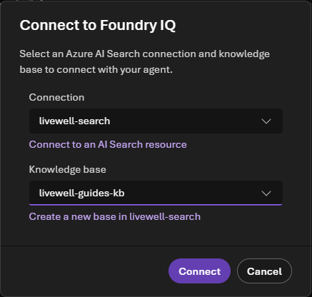
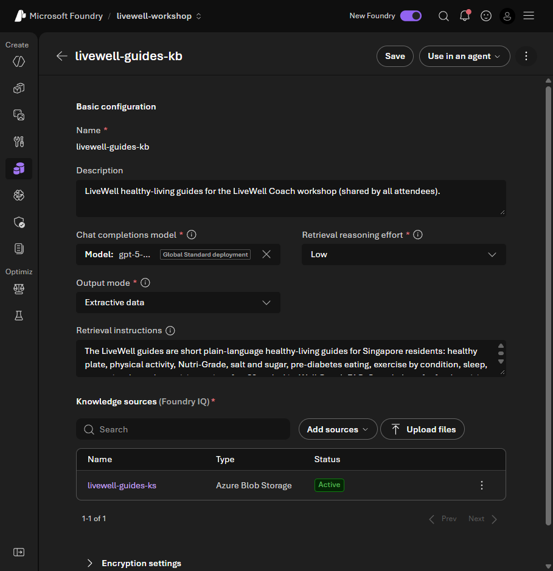
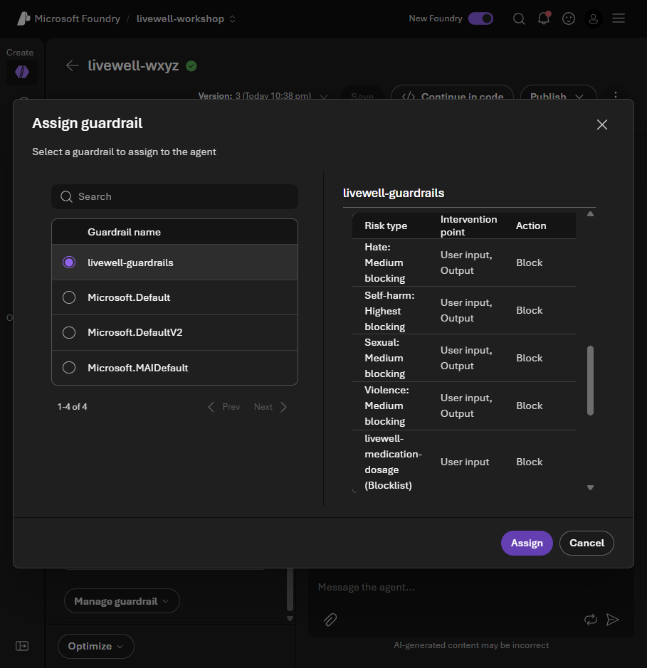
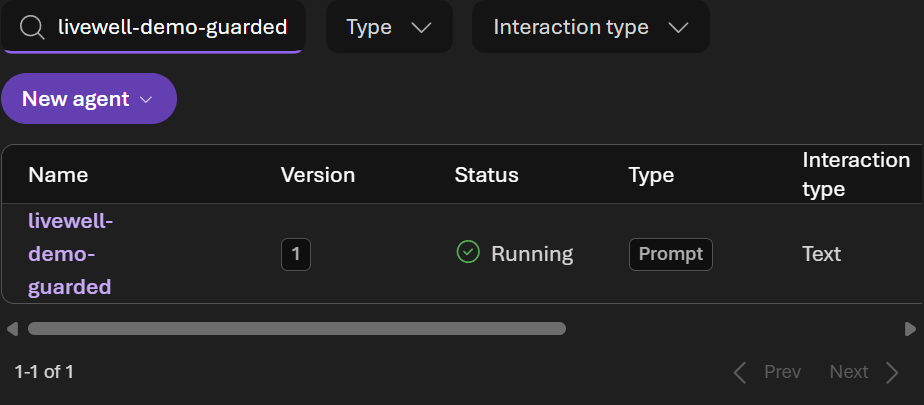

# Facilitator demonstrations and preparation

These notes are not participant tasks. The participant guides contain only their chosen track's actions.
Use [the delivery runbook](HPB-DELIVERY-RUNBOOK.md) for environment selection, approvals and teardown, and
[admin setup](ADMIN-SETUP.md) for connections, RBAC and deployment. Keep identifiers, endpoints and access links
in the private values sheet, not in this file or slides.

## Before showing a demonstration

- Check the selected MCAPS environment and existing resources; never rely on the CLI's unrelated default.
- Do not deploy, change access, resume capacity, run evaluations or start red-team scans without the relevant approval.
- Demonstrate with synthetic data. Shared `livewell-demo-*` and `livewell-workshop-*` agents are protected; chat and inspect only.
- Record recovery attempts separately from first-attempt success. Elevated facilitator access is not attendee-only RBAC proof.
- Supply the prepared screenshots/results if a participant is blocked; do not ask them to keep rerunning prompts.

## Lab 0: first-agent explanation

Use the introduction and diagnosis refusal to distinguish intended behaviour from a safety guarantee.
Navigator saves a portal agent; Builder's `lab0_setup.py` creates its own `livewell-<initials>-coach`.
The tracks do not share agent state and participants should not switch midway.

Permissions and first-time sign-in preparation belong in [admin setup](ADMIN-SETUP.md) and
[tenant bootstrap](TENANT-BOOTSTRAP.md), not in the participant click path.

## Lab 1: Foundry IQ internals

The class reuses `livewell-guides-kb-mcp` under **Available knowledge bases**. If it is missing, repair the
prepared connection outside the participant exercise. The alternative **Connect to Foundry IQ** route
selects `livewell-search` first and may create a new project connection.

For a deeper explanation, inspect the shared KB settings read-only: question planning, hybrid search,
ranking and extractive passages. Do not save changes while the room is using the KB.

Multi-document intake is no longer a participant exercise. Retained schema/data fixtures are not a delivery requirement.

## Lab 2: evaluations and the control-plane demonstration

**Participants run no evaluations.** Show `LiveWell guardrail matrix 2026-10-26 20:51` and keep the
[schema-2 capture](../data/lab2-prepared-eval.json) available. Compare default/custom for the same model.
This matrix measures `guardrail_blocked`, `handled_safely` and `self_harm`, not groundedness or each participant's agent.

The benign dose reminder is an over-block. The judge-filtered flyer is not scored. A **Too few samples**
banner is expected for a small teaching set; do not submit more runs simply to clear it.

Explain the policy settings without asking participants to edit them:

If assignment is unavailable for an attendee, they may inspect the existing guarded comparator without editing it:

The separate [`lab2_evaluate.py`](../assets/lab2_evaluate.py) is optional facilitator code reading. Its default
execution makes no cloud calls; paid `--run` needs separate approval. See
[shared evaluation preparation](ADMIN-SETUP.md#lab-2-shared-evaluation) for version pinning, evidence and upload handling.
Red-team material is likewise a separately approved facilitator demonstration, never participant work.

## Lab 3: connections, identity and specialists

Prepare the Anonymous `livewell-profile-openapi` connection once per environment and verify the API-root target.
The [OpenAPI prerequisite](ADMIN-SETUP.md#profile-openapi-connection) is an operator step.

The demo profile's `me` is fixed synthetic Rahim, not authenticated citizen identity. Anonymous access is a workshop
shortcut; application identity and resident authorisation are different concerns in production. Registrations are
temporary synthetic records, not real bookings.

Prepare `livewell-nutrition-a2a` and `livewell-activity-a2a` before the optional participant extension.
Incoming A2A, agent cards and the project's consumer-role assignment are facilitator setup. The current portal
marks A2A preview. Verify actual calls; the prior walkthrough needed an Activity follow-up after Nutrition alone.

## Optional Fabric extensions

The participant step compares only `fabric_q_disengaged_regions` with `lab1_prediabetes_eat`.
Check active capacity, published ontology context and user access before enabling it. If paused, obtain approval
for a bounded resume/check/pause window; do not leave F2 active after the approved work.

Further demonstrations, only with time and approval:

- `lab3_programme_fit`, then `lab3_programme_confirm`: profile first, an age-band-only Fabric question,
  activity discovery and explicit approval before synthetic registration. Never send an individual identifier to Fabric.
- `lab4_q_programmes_disengaged`: the separate Programme-Insights specialist, not a fourth DevUI team member.

The reference question bank is [here](../fabric/question-bank.md). Current ontology context produces source-native
SQL/KQL/DAX. Legacy GQL samples are historical diagnostics, not required current-runtime output.
The existing `lab3_tools.py --fabric` extension also runs Lab 3 and programme fit; it is not the participant's
short read-only `lab3_fabric.py` command.

## Lab 4: shared access and hosted-agent demonstration

The participant core uses the prepared sequential and hand-off teams. Generate a fresh private launch link
with `scripts/render-values.py` shortly before use; it expires after ten hours by default.
Distribute only the private link and expiry. Never share the backend bearer token or publish the launch URL.

The session list is shared. Use fresh sessions, stagger runs, and inspect live events; the pinned DevUI can
fail to reopen saved workflow messages. DevUI exposes local hand-off calls, not every Foundry-hosted MCP operation.

### Optional hosted proof

`livewell-workshop-hosted` is already deployed. Do not deploy or publish during the participant lab.
With your facilitator account, inspect its active version, ask `lab1_prediabetes_eat` and open its trace.
The hosted sequential team has the attached `livewell-guardrails` policy; DevUI uses the deployment's default policy.
These are different policy boundaries.

Publishing instructions stay in the [hosted-agent README](../assets/hosted-agent-example/README.md).
The participant Builder guide links the [Microsoft Learn hosted-agent tutorial](https://learn.microsoft.com/en-us/azure/foundry/how-to/develop/vs-code-agents-workflow-pro-code)
as optional further learning, not as a requirement to deploy.

## Participant-flow check record — 29 October 2026

The DevUI checks used fresh Edge contexts, the private launch link and the documented form, not a bypass of browser authentication.
Actual response-stream events and screenshots were retained; raw run evidence stays ignored.

| Check | Observed result |
|---|---|
| Private access and input form | Sequential selected automatically; no token-entry form or native bearer in local storage. Captured the ready form without an extra model submission. |
| Sequential week plan, first attempt | Nutrition answered, then Foundry IQ retrieval exceeded its 90-second runtime. This was a real failed run, not counted as a pass. |
| Sequential week plan, one fresh-session recovery | Completed with Nutrition, Activity and Coach outputs. The published successful screenshot is this recovery. |
| Week-plan hand-off | Completed; actual function-call events were `handoff_to_nutrition`, then `handoff_to_activity`. Activity answered last. A screenshot-selector issue after completion did not trigger a repeat model call. |
| Activity-only sequential | Completed with all three stages, including unnecessary Nutrition work. |
| Activity-only hand-off | Completed with only `handoff_to_activity` and Activity output. Green/repeated timeline rows were not used as invocation proof. |
| Fabric | F2 was Paused and the browser needed sign-in. The user deferred live Fabric screenshots. No resume, Fabric query or new Fabric result capture was performed. |

Five workflow submissions in total: the four documented comparisons plus one explicit sequential recovery.
No evaluation, red-team run, deployment, account/RBAC change or capacity action was made. This is not a load test,
attendee-only permissions rehearsal, or new live verification of the Builder scripts. The new Builder entry points
have offline execution/guard tests; a live Fabric run remains pending.
