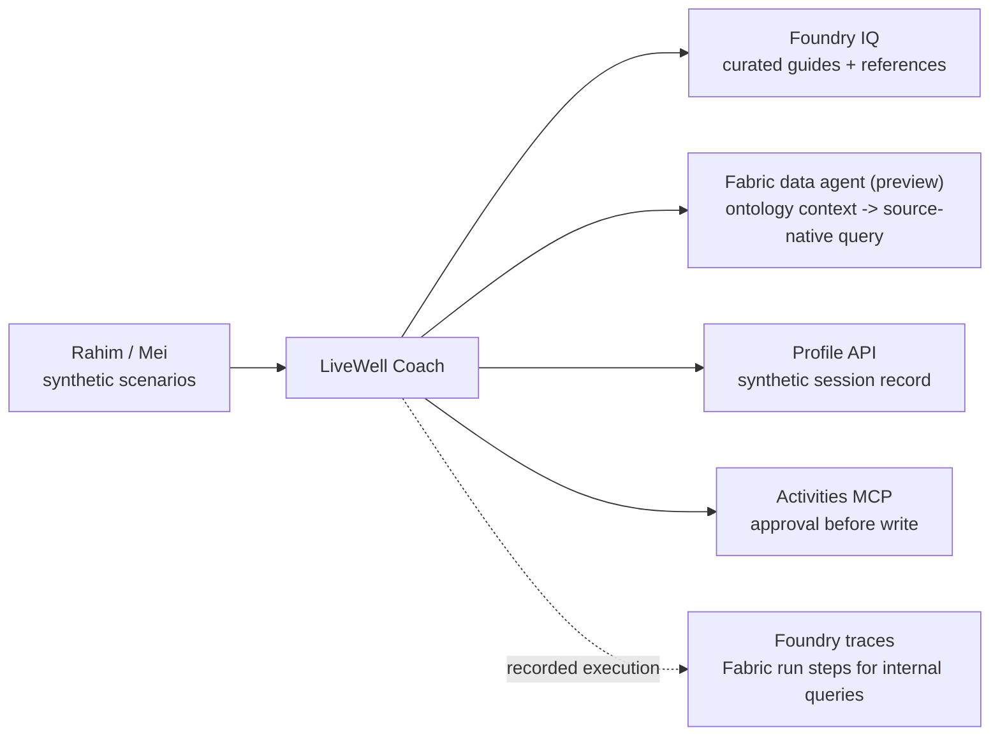

# Bridge spotlight · Two IQs, one agent

**8 min · 5:22–5:30** · **Facilitator-led recap, no build** · **Level:** L200 · **Patterns:** revisit #1–#10

**You are here:** [Lab 3](lab-03.md) → [Fabric step](fabric-step.md) → [Lab 4](lab-04.md) → **Bridge** · [README](../../README.md)

## Shared objective

> Know when to reach for Foundry IQ (documents and knowledge) versus Fabric IQ (governed business data and ontology), and how to connect them

## Foundry features covered

Knowledge and data grounding · tool boundaries · human approval · cloud observability. Fabric IQ and ontology context are **preview**.

## Story chapter

[Chapter 5](../narrative/rahim.md#chapter-5--two-iqs-one-agent-bridge-spotlight) closes the loop: the data estate describes residents and programmes; the coach uses appropriate evidence to answer and act. No new resource, agent or connection is created in this recap.

## 🟢 Navigator

### 1. Follow the architecture



### 2. Choose a path

| Need | This workshop uses | Evidence to inspect |
|---|---|---|
| An answer from approved guidance | Foundry IQ | Retrieved passage supporting the claim |
| A count across governed records | Fabric data agent | Aggregate question, selected source and result |
| One synthetic resident's profile | Profile API | Lookup output and allowed identifier |
| Register interest | Activities MCP | Proposed arguments, explicit approval and result |

This table describes **our design**, not exclusive product capabilities. Foundry IQ can use different kinds of sources; Fabric is not restricted to this sample's statistics.

### 3. Explain the boundary

Mei asks `bridge_q_dropped_attended_heldin`:

```text
Among residents who dropped a programme, how many attended at least one event, broken down by the region where those events were held?
```

**Predict:** should the grouping use a resident's home region or an event's location?

**Inspect:** the facilitator shows captured evidence or an already-available run. The question and answer must be aggregate-only. The reference counts **<!--ref:q_dropped_attended_heldin.distinct_residents-->248<!--/ref-->** distinct residents; **<!--ref:q_dropped_attended_heldin.top_region-->Central<!--/ref-->** has **<!--ref:q_dropped_attended_heldin.top_residents-->95<!--/ref-->**. A person attending events in two regions counts in both region groups.

**Explain:** ontology context supplies business meaning; the underlying source executes the query. Foundry's tool span is not a full record of Fabric's internal query execution. A separate diagnostic run is not automatically the same run as the coach's trace.

No live invocation is required to complete this recap; paused Fabric can stay paused.

<details>
<summary><strong>Further reading: current runtime and other integration options</strong></summary>

Current [ontology-context guidance](https://learn.microsoft.com/fabric/data-science/data-agent-ontology-sources) separates business semantics from execution: Fabric generates SQL, KQL or DAX for the selected underlying source. Inspect that source's query and error in Fabric run steps; do not expect GQL from the current context path.

Other designs include [OneLake content as a knowledge source](https://learn.microsoft.com/azure/search/agentic-knowledge-source-overview), a Fabric data agent exposed through a supported connection, and an existing scoring API as a tool. Availability and preview support depend on the chosen source and region. None is configured during this recap.

The semantic distinction remains important: **event region is not home region**. The names `attended`, `heldIn` and `livesIn` explain the data relationship; they do not require every runtime to execute a graph traversal.

</details>

## 🔵 Builder

There is no participant code task. The facilitator may expand the historical replay below; it is not required to understand the two grounding paths.

<details>
<summary><strong>Historical GQL replay only: earlier Fabric runtime</strong></summary>

The repository's `fabric-steps.py` visualiser recognises **legacy GQL run steps**. Its October 2026 samples and screenshots are historical examples, not current source-native runtime proof.

```bash
python demos/fabric-steps.py --replay bridge --open
```

This reads saved data without calling Fabric or resuming capacity. Prefer the committed sample if a newer saved run uses another runtime. A replay is labelled with its capture date; it must not be presented as the current hosted execution.


The old [GQL question bank](../fabric/question-bank.md#canonical-gql-the-graph-check) remains for graph-specific validation and historical comparison. For the current data-agent context integration, use Fabric's native run steps and documented source-native queries.

</details>

## Checkpoint

✅ **Built** an explanation of which evidence source fits which question.

✅ **Did** a discussion of the source, grouping and tool boundary—not a new deployment.

✅ **Learned** to choose the grounding path and inspect its evidence before adding more tools.

Nothing to submit. Name one source for guidance, one for cohort statistics, and one action that must wait for approval.

<details>
<summary><strong>Expected discussion</strong></summary>

“Use retrieved guidance when a claim needs an approved source. Use governed data when an answer needs a calculation. Inspect tool arguments and results, not only final prose. Permission and explicit approval remain separate concerns.”

For Mei's question, group by where events were held. Counts across region groups can exceed the distinct-resident total because people may attend in multiple regions. A result mismatch is a reason to inspect the query and data, not to invent a replacement answer.

</details>

## Troubleshooting

<details>
<summary><strong>Unavailable demo or different query details</strong></summary>

Use the diagram and computed reference discussion if a demo is unavailable. If the old visualiser cannot recognise a run, that means **unsupported diagnostic format**, not “the agent did no retrieval”. Ask the facilitator to inspect current Fabric run steps. Stop if an example exposes individual records.

</details>

## Where next

Close on **Unify → Govern → Personalise → Converse → Coach & Act**, and the ten patterns in [README](../../README.md). The optional details remain available after the workshop.
