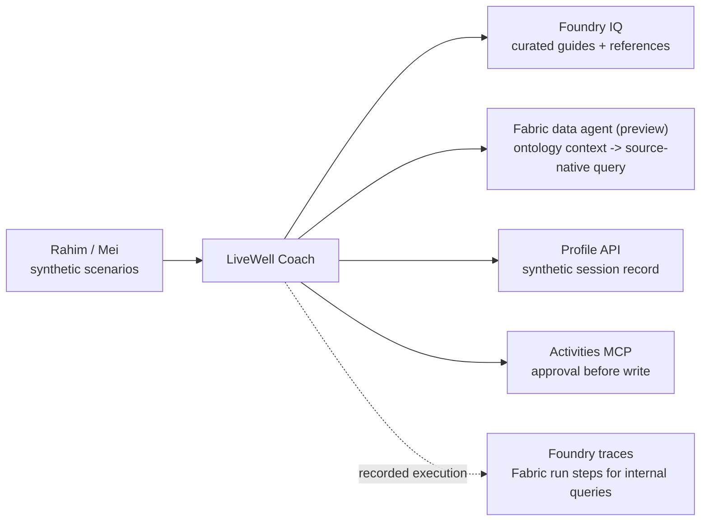

# Bridge spotlight · Two IQs, one agent

**8 min · 5:22–5:30** · **Facilitator-led recap, no build** · **Level:** L200 · **Patterns:** revisit #1–#10

**You are here:** [Lab 3](lab-03.md) → [Fabric step](fabric-step.md) → [Lab 4](lab-04.md) → **Bridge** · [README](../../README.md)

**Your path:** [Navigator / watch](#navigator) · [Builder reference](#builder) · [Checkpoint](#checkpoint) · [Troubleshooting](#troubleshooting)

## Shared objective

> Know when to reach for Foundry IQ (documents and knowledge) versus Fabric IQ (governed business data and ontology), and how to connect them

## Foundry features covered

Knowledge and data grounding · tool boundaries · approval · cloud observability. Fabric IQ and ontology context are **preview**.

## Story chapter

[Chapter 5](../narrative/rahim.md#chapter-5--two-iqs-one-agent-bridge-spotlight) closes the loop: the data estate describes residents/programmes; the coach uses the right evidence to answer and act. No new resource, agent or connection is created.

## 🟢 Navigator

<a id="navigator"></a>

### 1. Follow the architecture



### 2. Choose a path

| Need | Workshop source | Evidence |
|---|---|---|
| Approved guidance | Foundry IQ | Retrieved passage supporting the claim |
| A count across governed records | Fabric data agent | Aggregate question, source and result |
| One synthetic profile | Profile API | Lookup output and allowed identifier |
| Register interest | Activities MCP | Arguments, explicit approval and receipt |

These are **our design choices**, not exclusive product capabilities.

### 3. Explain the boundary

Mei asks `bridge_q_dropped_attended_heldin`:

<!-- copy:prompt bridge_q_dropped_attended_heldin -->
```text
Among residents who dropped a programme, how many attended at least one event, broken down by the region where those events were held?
```
<!-- /copy -->

**Predict:** group by the resident's home or the event's location?

**Inspect:** the facilitator shows captured evidence or an already-available run. The reference has **<!--ref:q_dropped_attended_heldin.distinct_residents-->248<!--/ref-->** distinct residents; **<!--ref:q_dropped_attended_heldin.top_region-->Central<!--/ref-->** has **<!--ref:q_dropped_attended_heldin.top_residents-->95<!--/ref-->**. Someone attending events in two regions counts in both groups.

**Explain:** ontology context supplies meaning; the source executes the query. Foundry's tool span does not expose all Fabric internals. A separate diagnostic invocation is not automatically the same execution.

No live invocation is required; paused Fabric may stay paused.

<!-- historical-screenshot: screenshots/bridge/01-mei-multi-hop-answer.png -->
<!-- historical-screenshot: screenshots/bridge/02-fabric-iq-trace.png -->

<details>
<summary><strong>Further reading: current runtime and other integration options</strong></summary>

[Ontology context](https://learn.microsoft.com/fabric/data-science/data-agent-ontology-sources) separates semantics from execution. Fabric generates SQL, KQL or DAX for the selected source; inspect its query and error rather than expect GQL.

Other designs include [OneLake content as a knowledge source](https://learn.microsoft.com/azure/search/agentic-knowledge-source-overview), a supported data-agent connection or a scoring API as a tool. Preview support and availability vary. None is configured in this recap.

**Event region is not home region.** `attended`, `heldIn` and `livesIn` describe relationships without requiring every runtime to execute a graph traversal.

Optional background: [Microsoft IQ in Foundry](https://microsoft-foundry.github.io/forgebook/notebook/microsoft-iq-in-foundry/).

</details>

## 🔵 Builder

<a id="builder"></a>

No participant code task. The facilitator may expand the historical replay; it is not required.

<details>
<summary><strong>Historical GQL replay only: earlier Fabric runtime</strong></summary>

[`fabric-steps.py`](../../demos/fabric-steps.py) recognises **legacy GQL run steps**. Its October sample is historical, not current source-native runtime proof.

```bash
python demos/fabric-steps.py --replay bridge --open
```

This reads saved data without calling Fabric or resuming capacity. Prefer the committed sample when newer saved data uses a different runtime. Keep its capture date visible.


The [GQL question bank](../fabric/question-bank.md#canonical-gql-the-graph-check) remains for graph-specific validation and historical comparison. Current context integration uses Fabric run steps and source-native queries.

</details>

## Checkpoint

✅ **Built** an explanation of which evidence source fits which question.

✅ **Did** a discussion of source, grouping and tool boundary—not a deployment.

✅ **Learned** to inspect evidence before adding more tools.

Nothing to submit: name one source for guidance, one for cohort statistics, and an action needing approval.

<details>
<summary><strong>Expected discussion</strong></summary>

“Retrieve approved guidance for a sourced claim; query governed data for a calculation. Inspect arguments and results, not just prose. Permission and explicit approval are separate.”

For Mei, group by where events were held. Group totals may exceed distinct residents. A mismatch calls for inspecting query/data, not inventing an answer.

</details>

## Troubleshooting

<details>
<summary><strong>Unavailable demo or different query details</strong></summary>

Use the diagram and computed reference discussion. An unrecognised old-visualiser result means **unsupported diagnostic format**, not “no retrieval”. Ask the facilitator to inspect current Fabric steps. Stop if individual records appear.

</details>

## Where next

Close on **Unify → Govern → Personalise → Converse → Coach & Act**, and the ten patterns in [README](../../README.md).
