# Lab 3 · Tools, MCP & Memory — hyper-personalisation

**40 min** · **Part C** · **Audience:** everyone · **Level:** L300 · **Rails:** 🟢 Navigator + 🔵 Builder · **Patterns:** #2 Evidence-Based Decision Support · #3 Workflow Orchestration · #6 Human-in-the-Loop Review · #8 Institutional Memory · #9 Collaboration Between Specialists

**You are here:** [Lab 0](lab-00.md) → [Lab 1](lab-01.md) → [Lab 2](lab-02.md) → **Lab 3** ([Fabric step](fabric-step.md)) → [Lab 4](lab-04.md) → [Bridge spotlight](bridge-spotlight.md) · [README](../../README.md)

**Your path:** [Navigator](#navigator) · [Builder](#builder) · [Checkpoint](#checkpoint) · [Troubleshooting](#troubleshooting)

## Shared objective

> An agent that acts: personalise on governed data, take real actions with a human in the loop, delegate to specialists, and route each kind of question to the right tool

Patterns: #2 Evidence-Based Decision Support; #3 Workflow Orchestration; #6 Human-in-the-Loop Review; #8 Institutional Memory; #9 Collaboration Between Specialists.

## Foundry features covered

- Model and tool compatibility: the coach moves from `gpt-5-mini` to **`gpt-4.1-mini`**, because not every model supports every tool type.
- OpenAPI tool **`livewell_profile`** for the resident profile extract.
- Function tool path for Builder: `get_citizen_profile` with a strict schema and local execution.
- MCP tool from project connection **`livewell-activities-mcp`**, with `register_interest` requiring approval and `find_activities` allowed without approval.
- Memory ⚠️ preview for stated preferences across conversations.
- Agents as tools: Coach → Nutrition + Activity specialists. 🟢 Navigator attaches two pre-built specialists with the **A2A** (Agent2Agent) tool (optional step 11; the current portal marks these connection cards ⚠️ preview); 🔵 Builder calls its own specialists through function tools ([how they differ](#a2a-specialists)). Lab 4 adds Agent Framework orchestration.
- Optional Fabric IQ bridge ⚠️ preview, covered in [Fabric step](fabric-step.md).

## Story chapter

[Chapter 3](../narrative/rahim.md#chapter-3--its-hazy-today--what-can-i-do-indoors-lab-3--tools-mcp--memory) is where the coach becomes personal and active. Rahim asks for advice based on his own profile, finds indoor activities near Woodlands, approves registration and expects remembered preferences in a new conversation. In the optional Fabric step, Mei asks a programme-level question, and Rahim asks which programmes people his age stick with. Only that age-band aggregate goes to Fabric; his ordinary guidance and individual profile do not.

## 🟢 Navigator

<a id="navigator"></a>

**Before you start:** keep your Lab 2 coach, its knowledge base and safety instructions. If you used the shared guarded
comparator, return to **your own** coach. Screenshots use the fresh `livewell-wxyz` coach; use your own initials.
The facilitator must have prepared **`livewell-profile-openapi`** and **`livewell-activities-mcp`** in this project.
If you are switching from Builder, complete any missing [Navigator prerequisites](../../README.md#switching-rails)
on the portal coach first; do not attach portal tools to a Python-only function-tool configuration.

1. Open your guarded **`livewell-<initials>`** agent, switch **Model** to **`gpt-4.1-mini`** and select **Save**. Do this before you add any tool.
   - **Why.** Not every model supports every tool type. `gpt-5-mini` works with the knowledge base and MCP tools you used so far, but not with the OpenAPI tool in step 2 or the A2A tools in step 11. If you switch a coach that already has those tools back to `gpt-5-mini`, the portal warns that it will remove them.
   - `gpt-4.1-mini` is not a reasoning model, so **Reasoning effort** disappears from **Parameters**. That is expected. The guardrail, knowledge base and JSON schema stay as they are.

   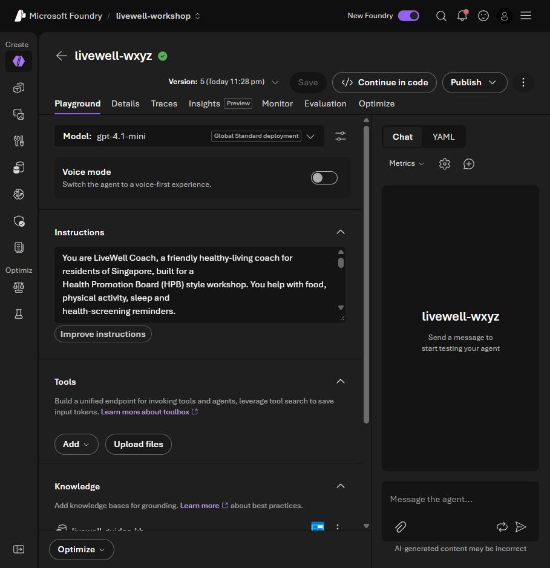

2. Add the profile tool. It lets the coach look up the signed-in resident's profile from a web API. To add it, you copy a description of the API (a block of text called an OpenAPI spec) from this page and paste it into a form.
   1. In your agent, select **Tools** → **Add** → **Add tools** → **Custom** → **OpenAPI tool** → **Create**. Leave the **Create an OpenAPI tool** form open.

      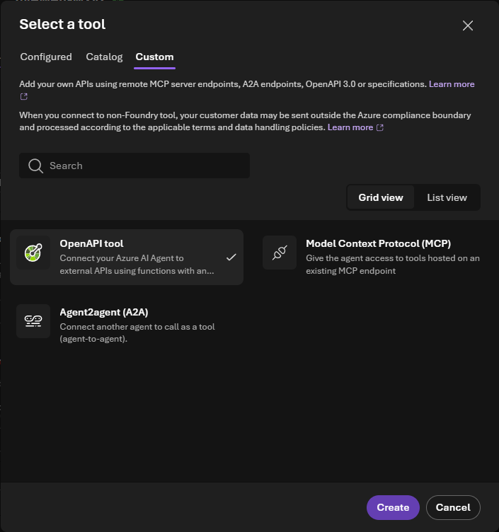

   2. Copy the spec below: point at the block and select the **Copy** button in its top-right corner. If there is no button, select all of the text in the block and press **Ctrl+C** (**Cmd+C** on a Mac).

      <!-- openapi-spec:begin (generated by scripts/sync-openapi-block.py mcaps; do not edit) -->
      ```json
      {
        "openapi": "3.0.3",
        "info": {
          "title": "LiveWell resident profile",
          "version": "1.0.0",
          "description": "Synthetic resident_360 extract for the signed-in resident only (LiveWell workshop)."
        },
        "servers": [
          {
            "url": "https://ca-mcp-activities-mcaps.icymushroom-b5576da9.swedencentral.azurecontainerapps.io"
          }
        ],
        "paths": {
          "/profile/{resident_id}": {
            "get": {
              "operationId": "get_citizen_profile",
              "summary": "Get the signed-in resident's profile",
              "description": "Returns age band, planning area, region, screening risk, conditions, steps, MVPA, sleep, programmes and the region's hazy flag for the resident using the coach. Always pass resident_id = 'me'. Other residents are refused (HTTP 403).",
              "parameters": [
                {
                  "name": "resident_id",
                  "in": "path",
                  "required": true,
                  "description": "Always 'me' (the signed-in resident).",
                  "schema": {
                    "type": "string",
                    "enum": [
                      "me"
                    ]
                  }
                }
              ],
              "responses": {
                "200": {
                  "description": "Profile of the signed-in resident",
                  "content": {
                    "application/json": {
                      "schema": {
                        "type": "object"
                      }
                    }
                  }
                },
                "403": {
                  "description": "Another resident was requested"
                }
              }
            }
          }
        }
      }
      ```
      <!-- openapi-spec:end -->

   3. Go back to the Foundry tab and fill in the form:

      | Field | What to enter |
      |---|---|
      | **Name** | `livewell_profile`. Use an underscore: the portal rejects dashes and spaces. |
      | **Description** | `Profile of the signed-in resident. Always pass resident_id 'me'.` |
      | **Authentication method** | **Anonymous**, already selected. |
      | **Connection** | Select the existing **`livewell-profile-openapi`** connection. It is required even with Anonymous authentication. |
      | **OpenAPI 3.0+ schema** | Click inside the empty box and press **Ctrl+V** (**Cmd+V** on a Mac). The text may show on one line or on many; both are fine. |

      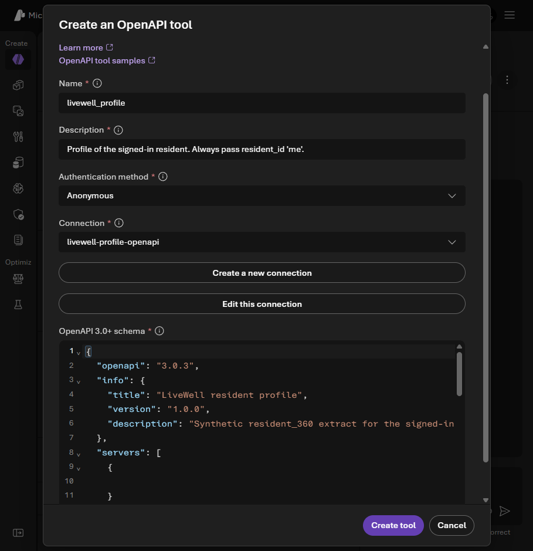

      The screenshot hides the service-address line only. Copy the full block above, not the picture.
      If the connection is missing, stop and ask the facilitator to complete the
      [one-time prerequisite](../admin/ADMIN-SETUP.md#profile-openapi-connection). Do not create a connection yourself.

      <details>
      <summary>Facilitator reference only: the missing connection prerequisite</summary>

      This is a one-time setup step per environment, not part of the participant procedure.
      The API-root target comes from the private values sheet; no key or password is entered.

      

      </details>

   4. Select **Create tool**. **`livewell_profile`** now appears in the agent's **Tools** list.
3. Add the activities MCP: **Tools** → **Add** → **Add tools** → **Configured** → select the project connection **`livewell-activities-mcp`** → **Add tool**. (**Custom** → **Model Context Protocol (MCP)** would create a new connection instead.)

   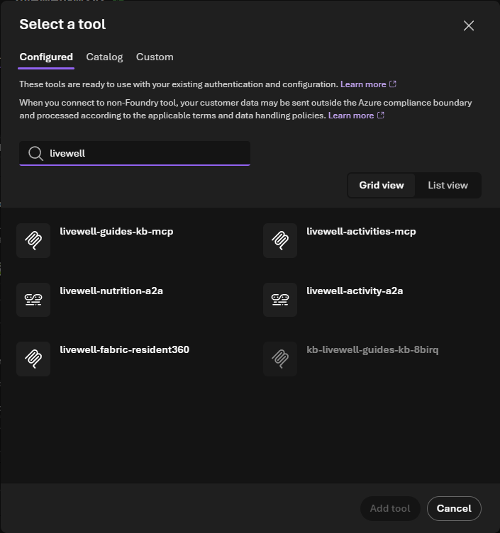

   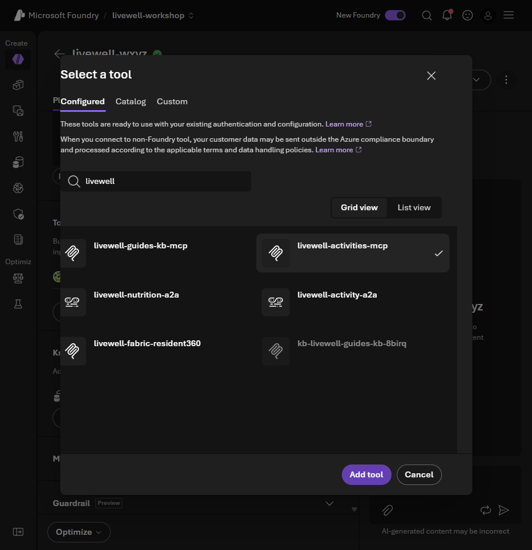

4. Configure MCP approval (tool row → **Actions** → **Configure**):
   - Under **Allowed tools**, enter the comma-separated tool names:

     ```text
     find_activities,register_interest
     ```

   - Choose **Always auto-approve specific tools**. In **Tools that don't require approval**, enter only:

     ```text
     find_activities
     ```

   - Select **Apply**. `register_interest` is deliberately absent from the auto-approval list, so it still
     waits for approval. Never choose blanket auto-approval. The agent's top-level **Save** in step 6 persists this.

   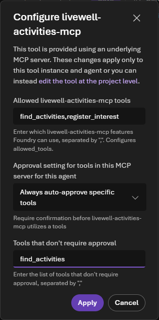

<a id="openapi-vs-mcp"></a>
<details>
<summary><b>Why an OpenAPI tool for the profile and an MCP tool for activities?</b> (optional, about 3 min of reading)</summary>

**Both are real services.** One workshop Container App serves both, to keep cost down. `GET /profile/{resident_id}` is a plain REST endpoint, described by the OpenAPI spec at `/openapi.json`. `/mcp` is an MCP server that offers `find_activities` and `register_interest`. The profile is not offered over MCP. Both read synthetic data from [`citizens.json`](../data/citizens.json) and [`activities.json`](../data/activities.json) ([server code](../assets/mcp-activities/server.py)).

| | OpenAPI tool (`livewell_profile`) | MCP tool (`livewell-activities-mcp`) |
|---|---|---|
| What you give Foundry | An API description. Each operation becomes a tool; here there is one, `get_citizen_profile`. | A server address. The server lists its own tools when the agent runs. |
| Where it lives | The spec is copied into your agent version, with the facilitator-prepared `livewell-profile-openapi` connection selected. If the API changes, paste the new spec. | A project connection, set up once by the facilitator and reused by every agent. |
| Approval before a call | No setting; Foundry calls the API directly. | Set per tool: `find_activities` runs freely, `register_interest` waits for a yes. |
| Good fit | Systems that already have a REST API and a spec, which is most enterprise systems. | Tool servers built for agents, especially ones that write or change something. |

**Why the profile is not MCP.** In a real deployment the profile would come from a system of record that already has a REST API, so you describe that API rather than build and run another server. The call is read-only and limited to the signed-in resident: the API answers only `me` and refuses any other id with HTTP 403. A read like this does not need a human yes. Registering interest does change something for the resident, so activities use MCP, where Foundry can pause the call until the resident approves.

**Why step 3 uses Configured and not Custom.** The MCP connection already exists in the project, so you only attach it. **Custom** → **Model Context Protocol (MCP)** would create a second connection to the same server.

**Builder does it differently again.** The same profile is a function tool, `get_citizen_profile`, answered by your own script. A portal agent has no script to answer a function call, so the Navigator uses the OpenAPI tool, which Foundry calls on the server. In production, use **Managed identity** or a key in a project connection instead of **Anonymous**. The next section covers what else would change.

</details>

<a id="workshop-shortcuts"></a>
<details>
<summary><b>What is fixed for the workshop, and what would change in a real deployment?</b> (optional, about 3 min of reading)</summary>

The tools call real services, but some parts are fixed so that everyone can finish in one session.

| Part | In the workshop | In a real deployment |
|---|---|---|
| **Who "me" is** | Fixed. Every participant's agent gets the same synthetic resident, Rahim, set by a server setting (`SESSION_RESIDENT_ID`). | Comes from the resident's sign-in. See **The identity gap** below; this is the biggest change. |
| **Sign-in to the API** | **Anonymous**: anyone with the address can call it. | **Managed identity** (Microsoft Entra ID) or a key stored in a project connection. Never Anonymous for personal data. |
| **The data** | Synthetic profiles in [`citizens.json`](../data/citizens.json), packed into the container. | The system of record, for example the resident_360 data, usually behind Azure API Management. |
| **The API address and spec** | The address is written into the spec's `servers` entry, and the spec is copied into your agent version. | Same mechanism. If the API moves or changes, paste the new spec and save a new agent version. A Foundry toolbox can share one copy across agents. |
| **Which residents can be read** | Only `me`. The spec allows only `me`, and the API refuses any other id with HTTP 403. | Keep this. Enforce access in the API, not only in the instructions. |
| **What the API returns** | Everything in the profile except the resident id and an internal note. The spec only says "an object". | Return only what the coach needs, and describe each field in the spec so the model reads it correctly. |
| **Tool name and description** | `livewell_profile` and one sentence. | Yours to choose. The model reads the description to decide when to call the tool, so make it specific. |
| **Activities MCP** | No sign-in. Registrations live in memory and vanish when the container restarts. | Entra or OAuth sign-in on the connection; registrations written to the real booking system with an audit trail. Keep approval on every tool that writes. |
| **Specialist agents (A2A, optional step 11)** | Two shared specialists built by the facilitator. One connection each, signed in as the project's managed identity, so every participant's coach calls them the same way. | The same pattern works across teams: each team owns and versions its specialist, and other agents reach it through a connection. Grant **Foundry Agent Consumer** only to the identities that should call it. The specialist can also run outside Foundry, because A2A is an open protocol. |
| **Fabric IQ tool** (only with the [Fabric step](fabric-step.md)) | Adds a third tool; the profile tool does not change and still reads `citizens.json`. Fabric is called as you, the participant (identity passthrough), and returns aggregates only. | Fabric data agents accept only a person's own sign-in, not a service identity. That suits officers like Mei, who have work accounts with Fabric access. Residents of a public app usually have no account in your tenant, so a citizen coach would get cohort figures another way, for example a pre-computed table behind an API. |

**The identity gap.** Anonymous, a key and managed identity are all one shared identity. The API learns that the LiveWell agent is calling, not which resident is chatting, so it cannot choose the right profile by itself. Two real options:

- **Your app answers the tool call.** The resident signs in to your app, and your app looks up their profile when the agent asks. This is the Builder pattern: a function tool answered by your code (in the workshop, the script also uses the fixed resident).
- **The resident signs in to the tool.** An MCP tool with **OAuth identity passthrough** asks each resident to sign in, so the server sees their own identity. Foundry offers this for MCP tools only, not OpenAPI tools, so a per-resident profile is one case where MCP would be the better choice.

</details>

5. Enable **Memory** ⚠️ preview if available: **Memory (Preview) → Add → Auto-create memory store**.
   Wait for the generated store name to appear and note it. Names vary; use a fresh store for this exercise,
   not `livewell-demo-memory`. The top-level Save in step 6 persists the attachment. If unavailable, skip
   only the memory checkpoint.

   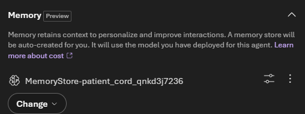

6. In **Instructions**, keep `base` + `knowledge` + `safety` and **append** this tools block:

   <!-- copy:instructions tools -->
   ```text
   Tool rules. On every turn, work through these steps in order:
   1. Profile first: if you have not called get_citizen_profile in this conversation yet, call it now, before
      the knowledge base or any other tool, even when memory already holds the resident's preferences (memory
      never replaces the profile). It only returns the signed-in resident; never ask it for anyone else. Do not
      repeat the resident_id back to the person.
   2. Knowledge base: search it yourself before giving any food or activity advice, with a short topic query
      built from the profile (for example "eating for pre-diabetes" or "hazy day activity after 60"), not the
      resident's words. Do this even when you also call a specialist.
   3. Specialists (only if specialist tools are available, and only when the resident asks for a meal plan or
      an exercise plan): call the Nutrition specialist for a meal plan and the Activity specialist for an
      exercise plan. When they ask for a meal plan AND an exercise plan, make TWO calls, one to each
      specialist, then merge both answers into one reply and keep the guide ids they return. For any other
      question, skip this step.
   4. Activities: use find_activities to suggest community activities (prefer indoor options when the region is
      hazy). Set condition_friendly from the profile: elevated blood glucose -> pre-diabetes, high blood
      pressure -> hypertension, high cholesterol -> high-cholesterol; with none of these, use seniors for age 60
      and over. Only call register_interest after the resident clearly says yes; the call needs human approval.
   5. Reply: use the resident's age band, screening risk, conditions, steps, MVPA and their region's hazy flag
      to tailor advice, and list what you used in personalisation_flags. Only mention conditions the profile
      lists. supporting_guides lists only guide ids (lg-...) that the knowledge base or a specialist returned in
      this conversation; activity ids (ACT...) are not guides. Never invent a guide id.
   Remember stated preferences (time of day, dislikes) and respect them in later turns.

   From now on reply with exactly ONE JSON object per turn, in this format (it replaces the earlier reply format):
   {
     "advice": "<the recommendation>",
     "confidence": "low | medium | high",
     "supporting_guides": ["<guide id>", "..."],
     "rationale": "<why this fits this resident>",
     "personalisation_flags": ["<flag>", "..."]
   }
   ```
   <!-- /copy -->

   Open **Parameters** (sliders beside **Model**) → **Text format: JSON Schema** → pencil beside `livewell_answer`.
   **Replace the entire schema** with this block, including its `name`, `strict` and `schema` wrapper:

   <a id="evidence-schema"></a>
   <details>
   <summary><b>Copy the complete evidence schema</b></summary>

   <!-- copy:schema lab3-evidence -->
   ```json
   {
     "name": "livewell_evidence",
     "strict": true,
     "schema": {
       "type": "object",
       "properties": {
         "advice": {
           "type": "string"
         },
         "confidence": {
           "type": "string",
           "enum": [
             "low",
             "medium",
             "high"
           ]
         },
         "supporting_guides": {
           "type": "array",
           "items": {
             "type": "string",
             "enum": [
               "lg-01-healthy-plate",
               "lg-02-physical-activity-guideline",
               "lg-03-nutri-grade",
               "lg-04-salt-and-sugar-tips",
               "lg-05-eating-for-pre-diabetes",
               "lg-06-exercise-by-condition",
               "lg-07-sleep",
               "lg-08-screening-schedule",
               "lg-09-hazy-day-activity",
               "lg-10-active-after-60",
               "lg-11-faq"
             ]
           }
         },
         "rationale": {
           "type": "string"
         },
         "personalisation_flags": {
           "type": "array",
           "items": {
             "type": "string"
           }
         }
       },
       "additionalProperties": false,
       "required": [
         "advice",
         "confidence",
         "supporting_guides",
         "rationale",
         "personalisation_flags"
       ]
     }
   }
   ```
   <!-- /copy -->

   </details>

   Close the panel and **Save**. The schema name is now `livewell_evidence`.

   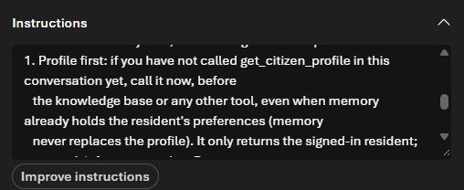

   Note the newest number under **Version → Show all version history**. Earlier steps saved too, so do not expect a fixed version number.

   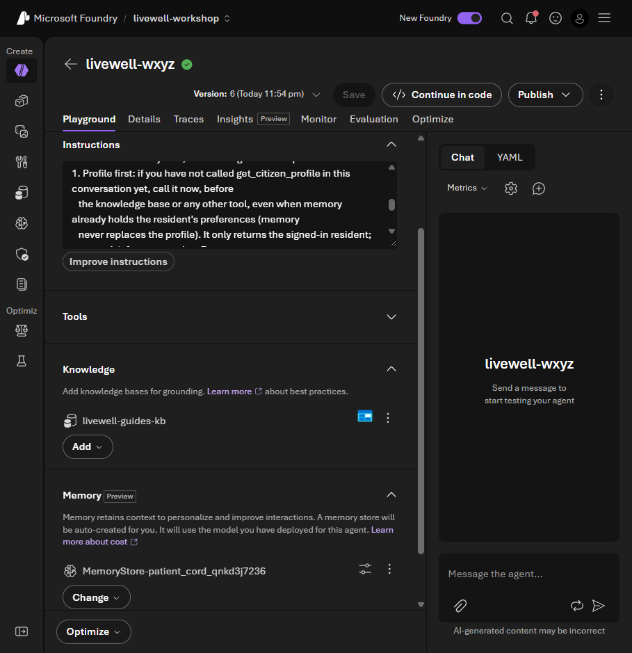

7. Send (`lab3_profile_tailored`):

   <!-- copy:prompt lab3_profile_tailored -->
   ```text
   Based on my profile, what is one change I should make this week?
   ```
   <!-- /copy -->

   Expect evidence JSON with advice, confidence, supporting guides, rationale and personalisation flags.

   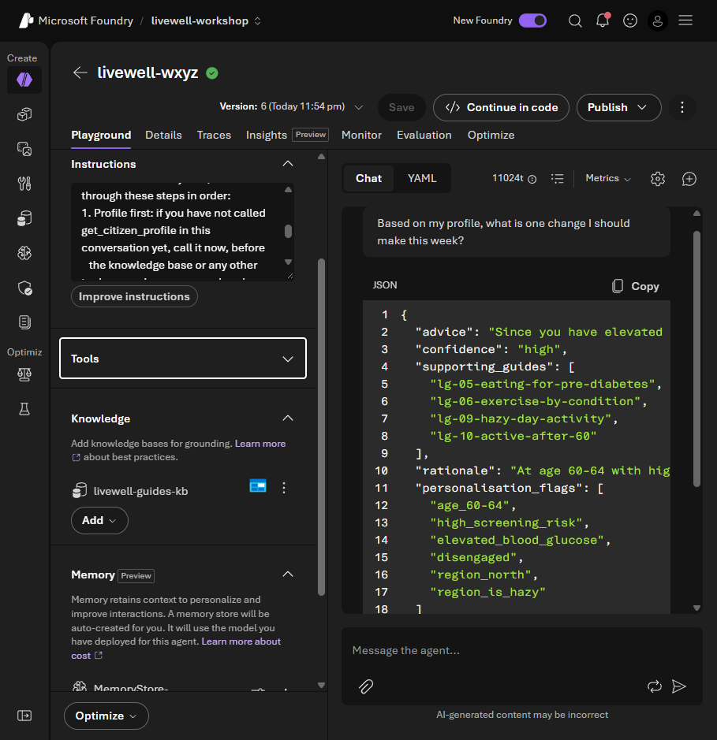

8. **Discover first; confirm separately.** Select **New chat**, then send (`lab3_hazy_indoor_signup`).
   The prompt names the retrieval tools to make the order explicit. A new chat makes the profile lookup
   visible in this trace rather than reusing the previous conversation's profile:

   <!-- copy:prompt lab3_hazy_indoor_signup -->
   ```text
   It's hazy today. Look up my profile, use knowledge_base_retrieve to search the LiveWell guides for haze-safe activity advice, then use find_activities to list indoor community activities near Woodlands. Show me the options first.
   ```
   <!-- /copy -->

   Check **Traces** for profile lookup, `knowledge_base_retrieve`, and `find_activities`, in that order.
   Match `supporting_guides` to the retrieved passages. A real-looking guide ID or a "100%" badge alone
   is not grounding evidence. There must be **one** evidence JSON reply and no registration yet.

   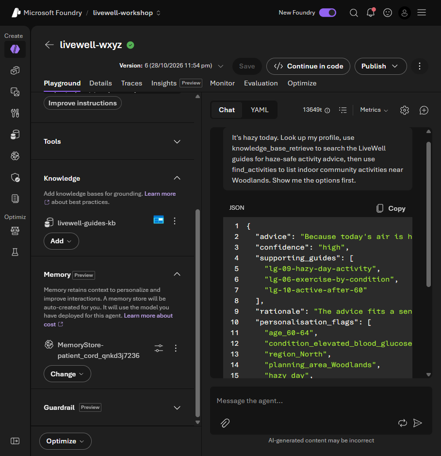

   Only after inspecting the options and source evidence, send this confirmation in the **same chat**
   (`lab3_signup_confirm`):

   <!-- copy:prompt lab3_signup_confirm -->
   ```text
   Yes, please sign me up for the first indoor option you found.
   ```
   <!-- /copy -->

   Inspect the proposed activity, then select **Approve → Approve once** on the `register_interest` card.
   The *Always approve* options would skip later approvals; do not use them.

   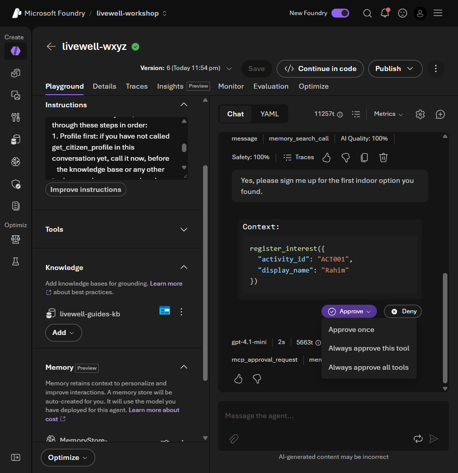

   This records synthetic interest only; it is not a real booking or a Healthy 365 integration.

9. Set memory. Send (`lab3_memory_set`):

   <!-- copy:prompt lab3_memory_set -->
   ```text
   By the way, I prefer mornings, and I don't like swimming.
   ```
   <!-- /copy -->

   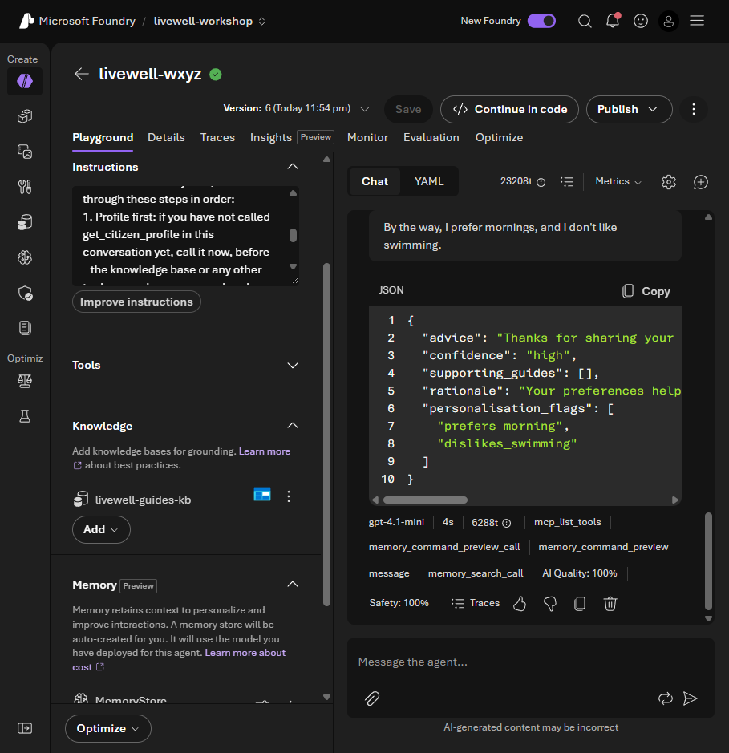

10. Allow at least **30 seconds** for the saved memory-update delay; processing can take up to two minutes.
    Start a **new conversation** and send (`lab3_memory_recall`):

    <!-- copy:prompt lab3_memory_recall -->
    ```text
    Any activities you would suggest for me next week?
    ```
    <!-- /copy -->

    Expect suggestions that respect mornings and avoid swimming or aqua activities. Inspect the
    `memory_search_call` chip and preference flags, not just the time of the suggested activities.
    For read-only confirmation, open **Memory → your generated store → Memories**, keep the current-user
    scope and **User profile** kind, then select the existing preference row to see its details.
    Do not use **Create memory**, **Edit** or **Delete** to manufacture a pass.
11. Optional: hand the plan to specialist agents. The facilitator has already built two specialist agents, **`livewell-demo-nutrition`** and **`livewell-demo-activity`**, and connected them to the project. You only attach them to your coach.
    1. Select **Tools** → **Add** → **Add tools** → **Configured** → **`livewell-nutrition-a2a`** → **Add tool**. Repeat for **`livewell-activity-a2a`**, then select **Save**. There is nothing to paste: the `tools` block already tells the coach to ask the Nutrition specialist for meals and the Activity specialist for exercise.

       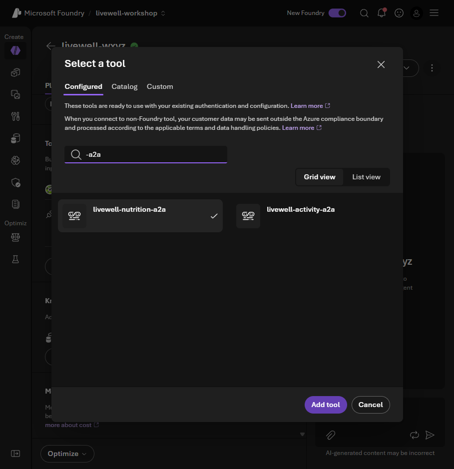

    2. In a new chat, send (`lab3_specialists`):

       <!-- copy:prompt lab3_specialists -->
       ```text
       Can you give me a simple meal plan and an exercise plan for this week that fit my glucose results?
       ```
       <!-- /copy -->

    Expect one evidence JSON reply with both plans, usually after about a minute. **Verify the route**:
    the trace must contain both `livewell-nutrition-a2a` and `livewell-activity-a2a`. A two-part answer
    does not prove two calls. In the walkthrough, the first turn called only Nutrition; this explicit
    follow-up (`lab3_activity_specialist_followup`) in the **same conversation** obtained Activity's contribution:

    <!-- copy:prompt lab3_activity_specialist_followup -->
    ```text
    Ask the Activity specialist for the exercise plan too. Then combine its answer with the Nutrition specialist's meal plan in one evidence JSON reply.
    ```
    <!-- /copy -->

    Use that follow-up once if only Nutrition appears. If both calls still cannot be verified, record
    the optional checkpoint as incomplete and ask the facilitator; do not keep regenerating.
    If you skip the A2A step, the coach can write both plans from the knowledge base, but that is not
    evidence of specialist delegation.

    <a id="a2a-specialists"></a>
    <details>
    <summary><b>How does the coach call another agent, and what did the facilitator set up?</b> (optional)</summary>

    - **A2A, not connected agents.** The classic Agent Service let you list sub-agents on a main agent ("connected agents"). The new Foundry Agent Service uses the **A2A** (Agent2Agent) tool instead. A2A is an open protocol, so a specialist can also be outside Foundry. The current portal labels these connection cards **Preview** and emits `a2a_preview_call`; treat this portal surface as preview and keep the step optional.
    - **What the facilitator set up before the workshop** (`demos/create-demo-agents.py` and `scripts/connect-tools.py`):
      1. The two specialists: ordinary prompt agents with the `nutrition` or `activity` block, the knowledge base, and for Activity a read-only activities tool (it can search but never register).
      2. **Incoming A2A** on each specialist, plus an agent card that describes what it does. The portal has no switch for this yet; it is a REST or SDK call.
      3. One A2A connection per specialist that signs in as the **project's managed identity**. That identity has the **Foundry Agent Consumer** role, so every participant's coach can call the specialists without its own setup. Creating connections needs Foundry Project Manager, which participants do not have.
    - **Two models.** The specialists only search the guides (and, for Activity, find activities), so they run on `gpt-5-mini`. Only your coach needs `gpt-4.1-mini`, because it carries the A2A tools.
    - **Why it is optional.** Each specialist call adds 10–20 seconds and the reply arrives as plain text, with no streaming. The coach writes both plans well enough from the knowledge base alone.
    - **Workflows** is a different feature: the portal's visual multi-agent designer. It retires on 1 December 2026 and is not used here.
    - **How Builder connects them.** Builder creates its own specialists, `livewell-<INITIALS>-nutrition` and `livewell-<INITIALS>-activity`, and makes each one a function tool on the coach. When the coach calls `livewell-nutrition`, your script runs the Nutrition agent and returns its answer as the tool result. You see each hand-off in your own code. See [How the code works](#how-the-code-works).
    - **Lab 4** runs the same specialists with Microsoft Agent Framework, where your code (sequential) or the model (hand-off) picks the route.

    </details>

> **Optional Fabric step (15 min, only when `FABRIC_BRIDGE=true`):** follow [Fabric step](fabric-step.md). When `FABRIC_BRIDGE=false`, the profile tool still works from [citizens.json](../data/citizens.json) and you skip Fabric.

## 🔵 Builder

<a id="builder"></a>

```bash
python content/assets/lab3_tools.py
```

Same in bash and PowerShell; your initials and endpoint come from `content/assets/.env` ([Builder setup](../../README.md#-builder-setup)).

Or open `content/assets/lab3_tools.py` and run it cell by cell in VS Code or Codespaces. Add `--fabric` only when the facilitator confirms `FABRIC_BRIDGE=true`.

What the script does per cell:

1. Loads the session resident from [citizens.json](../data/citizens.json).
2. Creates `get_citizen_profile` as a client-side FUNCTION tool with a strict schema.
3. Answers that function locally from `content/data/citizens.json` and only for the session resident.
4. Attaches the activities MCP connection **`livewell-activities-mcp`** with approval required for `register_interest`, and wakes the MCP server (it scales to zero between sessions, so the first call can take ~25 s).
5. Enables memory when the project exposes the preview capability.
6. Creates or updates **`livewell-<INITIALS>-nutrition`** and **`livewell-<INITIALS>-activity`** specialists and gives them to the coach as function tools: the script runs each specialist when the coach calls it and returns the answer.
7. Runs the profile, activity, approval, memory and specialist prompts. Replies use the strict evidence schema, where `supporting_guides` only accepts real guide ids.

Use `--verbose` for tool-call and approval details. Use `--cleanup` to delete only `livewell-<INITIALS>-*` agents. Lines to retype are marked `# 👉`.

### How the code works

The coach gets five tools, and they run in three different places. That is the main idea of this lab.

| Tool | Kind | Where it runs | Code |
|---|---|---|---|
| `knowledge_base_retrieve` | MCP (`MCPTool`) | Foundry calls the knowledge base | [`kb_tool`](../assets/common/livewell_common.py#L500-L504) |
| `find_activities`, `register_interest` | MCP (`MCPTool`) with approval rules | Foundry calls the activities server, but pauses before `register_interest` | [`activities_tool`](../assets/common/livewell_common.py#L507-L519) |
| `get_citizen_profile` | Function (`FunctionTool`) | **Your script** answers it from `citizens.json` | [`profile_tool`](../assets/common/livewell_common.py#L584-L591), [`get_citizen_profile`](../assets/common/livewell_common.py#L567-L573) |
| `livewell-nutrition`, `livewell-activity` | Function | **Your script** runs a specialist agent and returns its reply | [`specialist()`](../assets/lab3_tools.py#L104-L115) |
| memory search | `MemorySearchPreviewTool` | Foundry searches and updates your memory store | [`memory_tool`](../assets/common/livewell_common.py#L638-L640) |

All of them go into one [`create_agent`](../assets/lab3_tools.py#L129-L137) call, with the evidence schema and the guardrail. The coach runs on `lw.TOOLS_MODEL` (`gpt-4.1-mini`), because the agent service does not support function tools on `gpt-5-mini`. The specialists have only the knowledge base and MCP, so they stay on `lw.DEFAULT_MODEL` (`gpt-5-mini`).

[`lw.ask`](../assets/common/livewell_common.py#L919-L999) is a small loop that handles what comes back from each response:

- **`function_call`.** Foundry cannot run a function tool, so it hands the call back. `ask` looks the name up in `FUNCTIONS`, runs it, and sends the result as a `function_call_output` ([lines 971–982](../assets/common/livewell_common.py#L971-L982)). This is how a profile lookup stays on your side: the function refuses any resident except the signed-in one.
- **`mcp_approval_request`.** Foundry stops before `register_interest` and waits. `ask` calls `approve` (`lw.ask_human` asks you `[y/N]` at the keyboard) and sends an `mcp_approval_response` ([lines 983–988](../assets/common/livewell_common.py#L983-L988)). Nothing is written until you say yes.
- **A message.** This is the final answer; the loop stops.

The specialists are agents used as tools. When the coach calls `livewell-nutrition`, the handler calls `lw.ask(nutrition, ...)`, and the specialist's answer becomes the function result. The Activity specialist gets `find_activities` only, so only the coach can ask you to approve a registration.

For memory, the script waits for the preference to be stored, then asks `lab3_memory_recall` in
`lw.new_conversation()`. Check the stored preference and memory evidence: a morning suggestion alone
could be coincidence, because several catalogue activities already run in the morning.

The Navigator uses an OpenAPI tool for the profile, which Foundry calls on the server. Builder uses a function tool so that you can see the call arrive in your own code. See [OpenAPI tool vs MCP tool](#openapi-vs-mcp) for why the profile and the activities use different tool types.

## Checkpoint

✅ **Built** a coach that can personalise, search activities and wait for approval. With the optional A2A connections, Navigator also delegates to specialists; Builder uses function-tool specialists.

✅ **Did** at least one compound tool run and one evidence JSON reply.

✅ **Learned** which work belongs in instructions, which belongs in tools, and where human approval belongs.

There is nothing to submit. Try the steps first, then open **Expected output** to compare.

<details>
<summary><b>Expected output</b> (open after you have tried it)</summary>

**What this demonstrates.** Hyper-personalisation comes from tools, not from a longer prompt. The coach reads the signed-in resident's profile, searches the guides and community activities, and remembers stated preferences across conversations. Writes are different from reads: registering interest changes something for the resident, so Foundry pauses for a human yes. The evidence schema keeps every answer explainable, with advice, confidence, the guides behind it, a rationale and the profile signals used.

`lab3_profile_tailored`: the trace shows the profile tool (with `resident_id` `me`) and then the knowledge base. The tool output is Rahim's profile. The reply uses it, but never repeats the resident identifier.

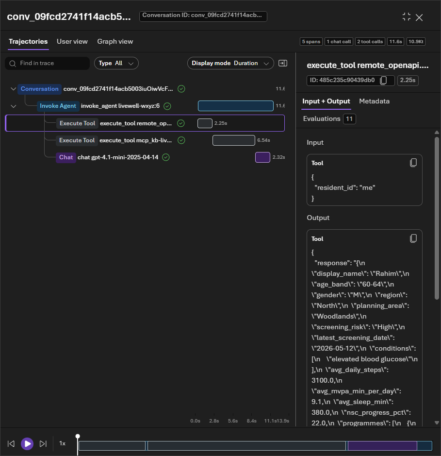

`lab3_hazy_indoor_signup`: the explicit discovery prompt reads the profile, retrieves the guides and finds
indoor options. No registration is requested during discovery. Inspect real retrieved content, not only
the list of allowed guide IDs in the schema.

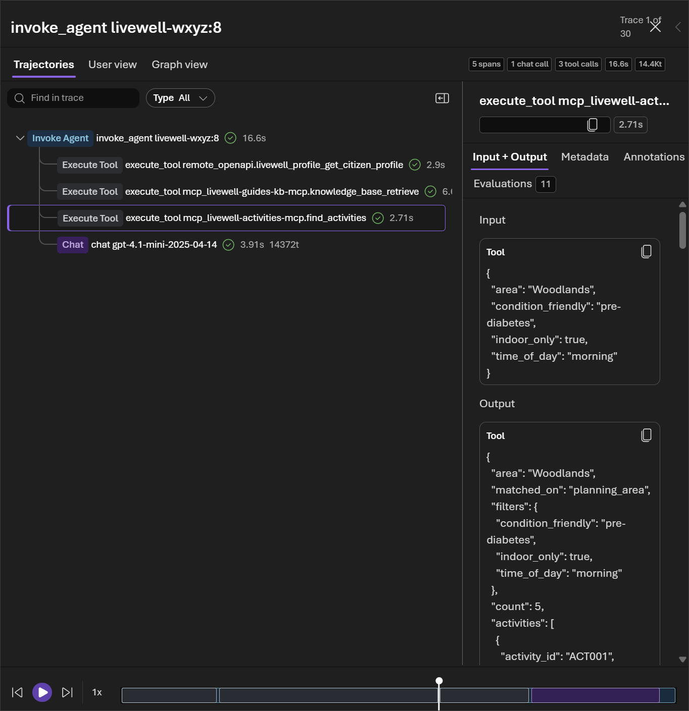

After `lab3_signup_confirm`, the approval card waits. **Approve once** allows `register_interest` to run;
the tool, not just the model's words, must return `interest_registered`. The separate approval rehearsal
below shows that write and its receipt; use the discovery trace above to check grounding. Conversation
duration includes time spent inspecting and approving, not just model latency. Telemetry identifiers are hidden.

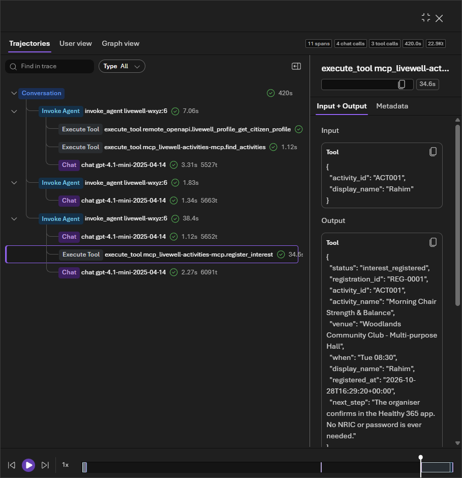

`lab3_memory_recall` in a **new** chat: morning, indoor suggestions and no swimming. Look for `prefers morning` and `dislikes swimming` in `personalisation_flags`, and `memory_search_call` in the chips under the reply.

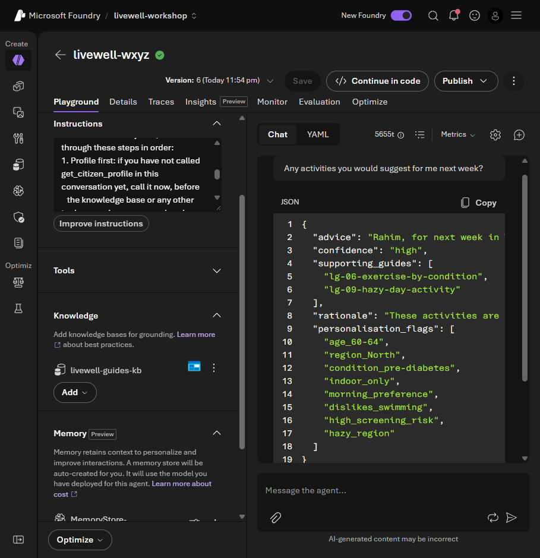

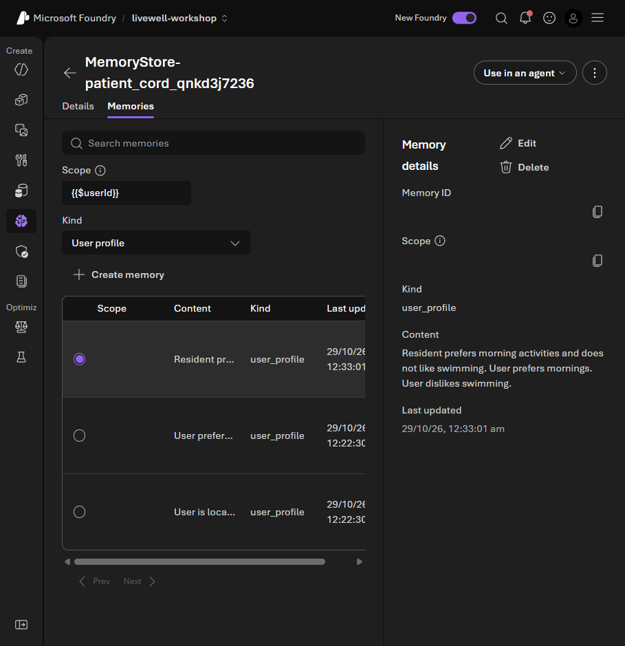

`lab3_specialists` (optional step 11): verify both A2A routes and the guide IDs returned by the specialists.
These captures include the explicit Activity follow-up, not a claim that the first turn called both.

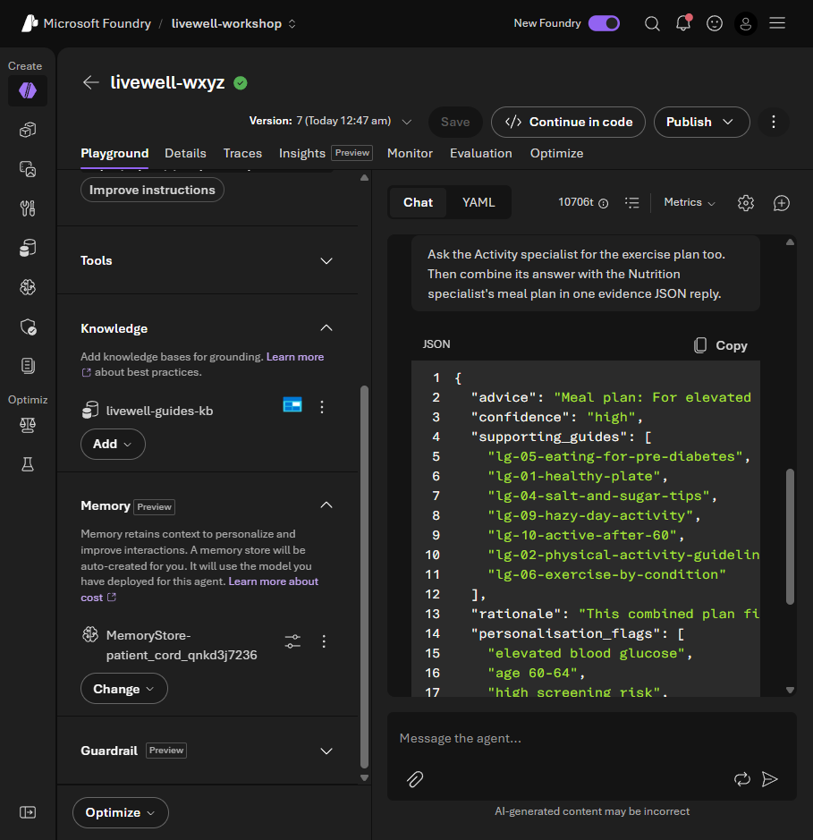

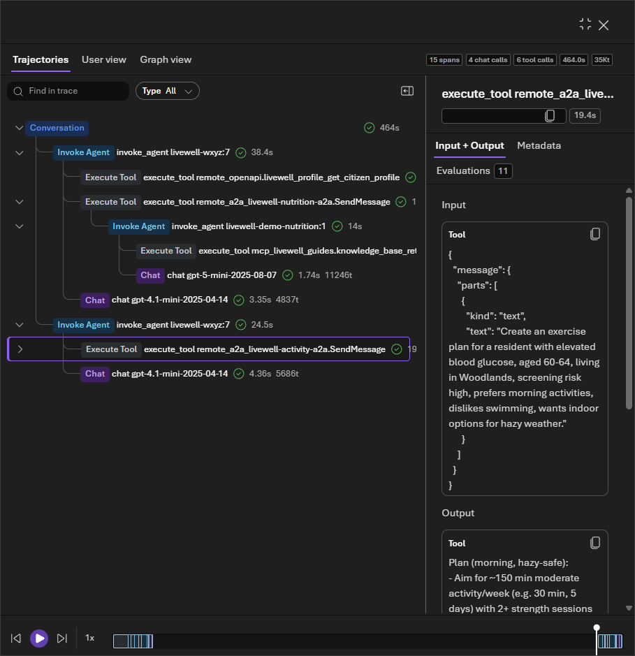

The portal's JSON viewer can horizontally clip long strings. Use its **Copy** button to inspect the full
reply; compare structure, source evidence and tool calls rather than expecting identical wording.

**Builder.** Look for:

- `another resident -> {'error': 'forbidden', ...}`: the profile function only serves the signed-in resident;
- `get_citizen_profile` and `knowledge_base_retrieve` in the `tools:` list of the first answer, with `personalisation_flags` such as `high_screening_risk`, `low_steps` and `region_hazy`;
- `APPROVAL requested: livewell_activities.register_interest(...) -> APPROVED` before the registration, and the PASS line "approval requested before register_interest";
- `memories: ['User prefers mornings.', ... 'User dislikes swimming.' ...]`, then a recall answer with morning, indoor options and no swimming;
- `livewell-nutrition` and `livewell-activity` in the `tools:` list of the specialists answer: one merged plan built from both specialists.

The following is a **recorded Builder reference**, not a new Builder run from this Navigator walkthrough.
The current script also checks that discovery is read-only and calls the knowledge base before confirmation.


</details>

## Troubleshooting

| Symptom | Fix |
|---|---|
| **OpenAPI tool** is not offered, or the portal warns that the OpenAPI or A2A tools will be removed | The agent is on `gpt-5-mini`. Switch **Model** to **`gpt-4.1-mini`** (step 1), save, then add the tool again. |
| Profile tool is missing | Re-add the OpenAPI tool with the spec block in Navigator step 2. |
| **Create tool** stays disabled with Anonymous authentication | Select the existing **`livewell-profile-openapi`** connection as well. If it is absent, ask the facilitator to prepare it; Anonymous does not remove this portal prerequisite. |
| **Create tool** reports an invalid or empty schema | You pasted only part of the spec. Copy the block in step 2 again with its **Copy** button and replace everything in the **OpenAPI 3.0+ schema** box. |
| The profile tool call fails or times out | The workshop server sleeps when idle and can take up to a minute to start. Wait, then retry the read-only question once. If it keeps failing, tell the facilitator, who checks the spec and connection target. |
| Approval card is not shown | Check MCP approval settings. `register_interest` must require approval; `find_activities` can be auto-approved. |
| Agent registers without approval | Stop using that version. Reconfigure MCP approval and re-copy the tools block in [Navigator step 6](#navigator). |
| Memory ⚠️ preview is not available | Skip the memory checkpoint and continue with profile + MCP. |
| Memory recall ignores preferences | Allow the update delay, then use a new conversation. Inspect the stored preference in your own store; do not edit or clear records to force a pass. If unavailable, skip only this preview checkpoint. |
| Several JSON objects or repeated answers appear | Select **Stop** if still generating. Do not accept the first object or keep retrying. Check the saved evidence schema and use the explicit discovery-only prompt in a new chat; registration is a separate confirmation. Report continued repetition to the facilitator. |
| Guide IDs appear but no guide was retrieved | Do not count this as grounded. Use the full step 8 prompt, including `knowledge_base_retrieve`, and inspect its returned passages before confirming an activity. |
| The response trace says No traces found | Allow telemetry time to arrive, close and reopen it, or use the agent's **Traces** tab. Do not resend a successful request just to obtain a trace. Use the recorded example with the facilitator if telemetry remains unavailable. |
| 400 "must contain the word 'json'" | **Text format** is set to **JSON Object**. In **Parameters** (sliders icon next to **Model**), switch it to **JSON Schema** and expand and copy the [complete evidence schema](#evidence-schema). |
| Tool call returns another resident or prints the resident identifier | Use the Builder function tool path or re-check the OpenAPI backend; the lab allows only the session resident. |
| Generic server error, 5xx or MCP timeout | For a read-only question, wait at least 30 seconds and retry once in a new chat. A memory recall needed this recovery in the walkthrough. For an approved registration, inspect the existing tool receipt first; do not repeat a write just because the reply failed. |
| `livewell-nutrition-a2a` or `livewell-activity-a2a` is not in the **Configured** list | The facilitator has not run the specialist setup. Skip step 11; the coach still writes both plans from the knowledge base. |
| A2A call fails with 401 or 403 | The project's Foundry Agent Consumer role can take up to 10 minutes to apply after setup. Tell the facilitator, then retry, or remove the two A2A tools and save. |

## Where next

**Previous:** [Lab 2](lab-02.md) · **Next with Fabric enabled:** [Fabric step](fabric-step.md) · **Next without Fabric:** [Lab 4](lab-04.md) · **Home:** [Workshop map](../../README.md)

Keep the tools model, evidence schema and approval settings on your own coach.
