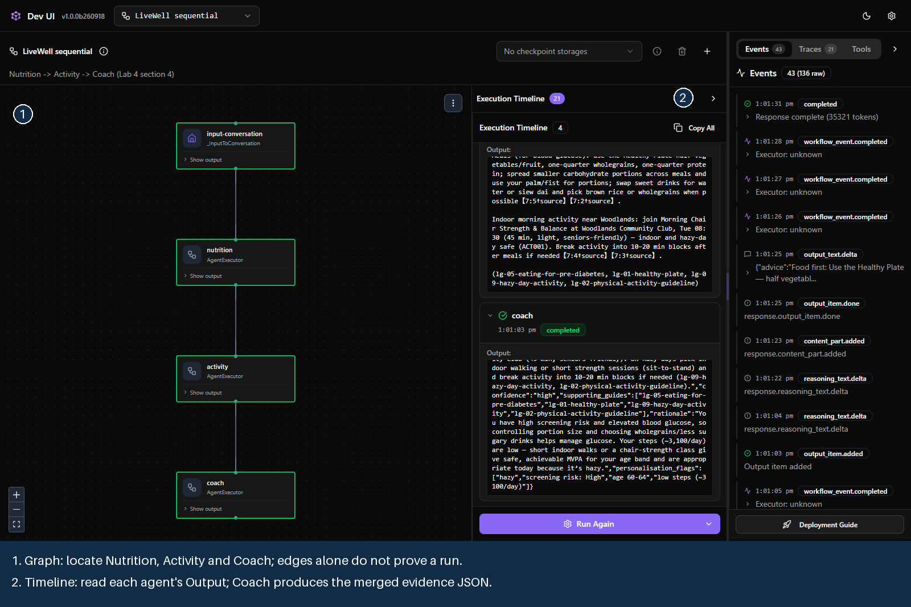
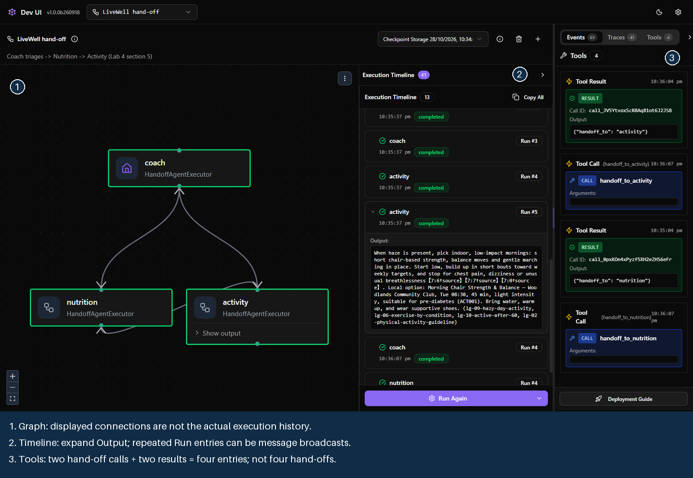
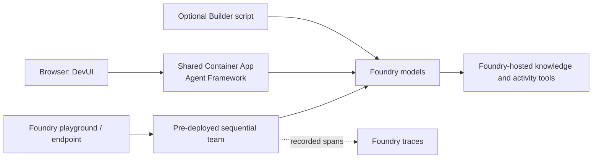

# Lab 4 · Multi-agent & Hosted deploy

**30 min total** · **25 min guided comparison at 1:15 + 5 min hosted proof at 5:15** · **Level:** L200; optional Builder detail L300 · **Patterns:** #3 Workflow Orchestration · #9 Collaboration Between Specialists · #10 Governance & Safety

**You are here:** [Lab 0](lab-00.md) → [Lab 1](lab-01.md) → [Lab 2](lab-02.md) → [Lab 3](lab-03.md) → **Lab 4** → [Bridge spotlight](bridge-spotlight.md) · [README](../../README.md)

**Your path:** [Navigator](#navigator) · [Builder](#builder) · [Checkpoint](#checkpoint) · [Troubleshooting](#troubleshooting)

## Shared objective

> Choose between one agent, sequential and hand-off workflows; use execution evidence to explain the route, then inspect the pre-deployed hosted team

## Foundry features covered

Microsoft Agent Framework orchestration · DevUI execution views (**pre-release development sample**) · Foundry hosted-agent traces, versions and guardrails · optional Fabric IQ specialist (**preview**, facilitator only).

## Story chapter

Rahim asks for food advice and an indoor activity. We compare two ways to coordinate specialists—not prove that his question needs multiple agents. [Chapter 4](../narrative/rahim.md#chapter-4--livewell-goes-live-lab-4--multi-agent--hosted-deploy) ends with the sequential team behind a hosted endpoint.

## 🟢 Navigator

<a id="navigator"></a>

**Already prepared:** one shared LiveWell demo with sequential and hand-off views. **No installation, deployment or token entry.** It starts on **LiveWell sequential**; your Lab 3 coach is unchanged. Follow the facilitator, then run in groups of no more than eight per workflow. Session lists and capacity are shared.

### Choose the simplest design that works

| Approach | Use it when… | Trade-off |
|---|---|---|
| **One agent with tools** | One instruction set handles the task. Start here. | Multiple tools do not require multiple agents. |
| **Sequential** | Every request needs known stages. | Predictable order, but every stage runs. |
| **Hand-off** | Requests need different specialists. | The model chooses among developer-permitted routes; choices can vary. |

Specialists may share a model; **instructions and tools** define their roles. Splitting work adds calls, latency and failure points.

### Why use DevUI?

A chat answer hides who did the work. DevUI connects the answer to the route and intermediate outputs; it is **not required** to build or deploy workflows.

| View | What to inspect |
|---|---|
| **Graph** | Agents and connections—not proof every edge ran. |
| **Execution Timeline** | Each agent's **Output** and the final answerer. |
| **Tools** | `handoff_to_…` calls that transfer control. |

**Limit:** this Tools panel shows local hand-offs, not Foundry-hosted `knowledge_base_retrieve` or `find_activities` calls. Inspect server-side traces for those where recorded.

### 1. Open the shared workflow

Click **Lab 4 private launch link (no token entry)** in the facilitator's private message. It handles access and opens **LiveWell sequential**. Allow 20–30 seconds on first load. **Do not forward or publish it**; it expires at the supplied time.

The graph can be inspected without a model run. **To run:** confirm workflow → **+** for a fresh session → **Configure & Run** → `user` in **role** → full prompt in **contents** → **Run Workflow**. Do not open or change someone else's session. Deployment controls are not used.

### 2. Predict → run → explain: fixed order

**Predict:** who should contribute to a food-and-activity plan?

Select **LiveWell sequential** and send the complete `lab4_week_plan_handoff` request:

<!-- copy:request lab4_week_plan_handoff -->
```text
Resident profile: age band 60-64, lives in Woodlands (North region, hazy today: yes), screening risk High, conditions: elevated blood glucose, about 3100 steps a day.

Plan my week: what to eat for my glucose, and one indoor morning activity near Woodlands.
```
<!-- /copy -->

**Observe:** Nutrition → Activity → Coach. Open their outputs; the Coach merges contributions into evidence JSON.

**Explain:** code fixes the order. Which earlier outputs did the Coach need?

### 3. Predict → run → explain: model-selected hand-off

Select **LiveWell hand-off**, start a fresh session, and reuse the complete request above.

**Observe:** read Tools from bottom to top: `handoff_to_nutrition`, then `handoff_to_activity`. This example ends with **Activity's answer**, not Coach-merged JSON. Both specialists should contribute.

**Explain:** developers permit hand-offs; the model selects them by calling tools. Point to the call that transferred control.

### 4. Predict → run → explain: an unnecessary specialist

**Predict:** does an activity-only request need Nutrition? Use a fresh session in each team with `lab4_activity_only`:

<!-- copy:request lab4_activity_only -->
```text
Resident profile: age band 60-64, lives in Woodlands (North region, hazy today: yes), screening risk High, conditions: elevated blood glucose, about 3100 steps a day.

Suggest one indoor morning activity near Woodlands for me this week.
```
<!-- /copy -->

**Observe:** sequential still runs Nutrition → Activity → Coach; hand-off should call only `handoff_to_activity`.

**Explain:** compare routes, not promised seconds. Hand-off also omits the Coach merge, so this is **not an equal-output speed benchmark**.

<a id="hosted-proof"></a>
### 5. Hosted proof: same sequential team, different host

At 5:15, inspect the **already-deployed `livewell-workshop-hosted`** with the facilitator. Find its answer and `workflow.run` trace; the facilitator shows the guarded endpoint. Nobody deploys or publishes during this exercise.

<details>
<summary><strong>Five-minute hosted portal walkthrough and screenshots</strong></summary>

1. Sign in to Foundry with your workshop account. This is separate from the DevUI private link.
2. **Build → Agents → `livewell-workshop-hosted`**. Chat and inspect only; do not edit this shared agent.
3. **Version → Show all version history → Details → Active version**. Do not change traffic.
4. **Playground → New chat**: send `lab1_prediabetes_eat`, or watch the facilitator:

<!-- copy:prompt lab1_prediabetes_eat -->
```text
My screening says my glucose is high. What should I eat to manage pre-diabetes?
```
<!-- /copy -->

5. **Response metrics → Traces**: inspect `workflow.run` and the specialist steps. Hosted publishing is facilitator-only, even if your account displays a Publish button.


<!-- historical-screenshot: screenshots/lab-04/06-hosted-agent-trace.png -->

Use the current trace rather than the archived capture. Missing access goes to the facilitator; do not deploy a replacement.

</details>

<details>
<summary><strong>DevUI screenshots: where to look, and why Tools says “4”</strong></summary>






**1 · Graph:** do not count highlighted boxes as model calls. Permissions and actual calls determine the route.

**2 · Timeline:** open **Output**. Repeated Run entries may record broadcast messages, not new model invocations. **Traces → OTel Spans** shows recorded timing and usage.

**3 · Tools:** four entries here mean **two calls plus two results**, not four hand-offs. `handoff_to_activity` transfers control; it does not search the activity catalogue.

These are captures, not a broadcast of the facilitator's current run.

</details>

<details>
<summary><strong>FAQ: DevUI, models, hosting and the Lab 3 connection</strong></summary>

**Microsoft or open source?** DevUI is Microsoft's MIT-licensed [Agent Framework sample](https://learn.microsoft.com/agent-framework/integrations/by-component/ui/devui/), not a production portal or drag-and-drop workflow designer. Agent Framework orchestrates; Foundry supplies models and hosted tools.

**My Lab 3 agents?** No. The shared app instantiates equivalent roles and instructions. Lab 3 memory and conversations do not transfer; the pasted synthetic profile provides context.

**A2A versus orchestration?** A2A reaches a specialist over a protocol. Sequential and hand-off decide who runs next. These DevUI teams use Agent Framework objects, without participant A2A setup.

**How does access work?** The private link exchanges for a secure, expiring browser session. The permanent token stays server-side; the container uses managed identity for Foundry. No participant token entry or Azure sign-in is needed for DevUI.

**Expired link?** Ask for a fresh one. A base address or bookmark without the access fragment does not grant first-time access. Anyone with the full link can use it until expiry. Session lists are shared, not individually isolated.

**One remote Foundry agent?** This is a shared container running the prepared team and two routing patterns, not a generic viewer attached to your agent or the separate hosted endpoint. That is how it exposes the graph and hand-offs.

**Same guardrail everywhere?** No. DevUI/local Builder uses the deployment's default policy. The hosted agent has **`livewell-guardrails`** attached. Specialist instructions alone are not a security boundary.

**Alternatives?** [Agent Inspector](https://learn.microsoft.com/azure/foundry/how-to/develop/vs-code-agent-inspector) supports compatible developer diagnostics; [Foundry tracing](https://learn.microsoft.com/azure/foundry/observability/how-to/trace-agent-framework) covers instrumented cloud execution. A generic endpoint does not automatically expose a graph. The portal **Workflows** item is not used.

</details>

<details>
<summary><strong>Optional facilitator extension: Programme-Insights and Fabric IQ (preview)</strong></summary>

This is a **separate specialist**, not a fourth agent in DevUI. Skip when Fabric is paused; core Lab 4 does not need it.

The facilitator sends `lab4_q_programmes_disengaged` to the prepared specialist:

<!-- copy:prompt lab4_q_programmes_disengaged -->
```text
Which programmes have the most disengaged residents enrolled?
```
<!-- /copy -->

Look for programme-level aggregates, with no resident detail. The computed reference puts **<!--ref:q_programmes_disengaged_enrolled.top_programme-->Healthier SG<!--/ref-->** first (<!--ref:q_programmes_disengaged_enrolled.top_disengaged_enrolled-->82<!--/ref--> disengaged residents enrolled); ±1 rank is accepted. Do not create agents or resume capacity for this optional observation.

</details>

### Under the hood

<details>
<summary><strong>Code map, routing rules and further reading</strong></summary>

[`demos/lab4-devui.py`](../../demos/lab4-devui.py) builds a fresh workflow per run; sessions remain shared. [`lab4_multiagent.py`](../assets/lab4_multiagent.py) is the Builder equivalent.



| Agent | Responsibility | Tools / output |
|---|---|---|
| Nutrition | Grounded meal advice | Knowledge retrieval; advice and guide IDs |
| Activity | Nearby suitable activities | Knowledge + read-only `find_activities` |
| Coach, sequential | Merge contributions | No tools; evidence JSON |
| Coach, hand-off | Select a permitted specialist | Hand-off tools; triage, not merge |

`SequentialBuilder` fixes the order. `HandoffBuilder` permits routes; Nutrition's first turn hides hand-off tools so it answers before an autonomous transfer to Activity. This is constrained orchestration, not unrestricted planning.

The [hosted implementation](../assets/hosted-agent-example/main.py) prepends a profile step and serves the sequential team over Responses. Hosting changes execution location, identity and policy—not the orchestration pattern.

Further reading: [sequential](https://learn.microsoft.com/agent-framework/workflows/orchestrations/sequential) · [hand-off](https://learn.microsoft.com/agent-framework/workflows/orchestrations/handoff).

</details>

## 🔵 Builder

<a id="builder"></a>

The browser exercise is sufficient. Expand only to inspect or run the implementation.

<details>
<summary><strong>Optional: run the canonical Python script</strong></summary>

```bash
python content/assets/lab4_multiagent.py
```

Use the existing [Builder setup](../../README.md#-builder-setup), or run the same `# %%` cells. These are live model calls, not replay.

Sections 1–3 build the profile, tools and roles; 4 runs sequential; 5 runs hand-off; 7–8 call the existing hosted team and print the checkpoint.

Default execution creates no Foundry agents. Section 6 needs **both `--fabric` and `FABRIC_BRIDGE=true`**, and is facilitator-only. Core Lab 4 needs no Fabric.

`--verbose` shows agent answers, `--no-handoff` skips hand-off, and `--cleanup` removes only your own agents. Demo/workshop prefixes are protected.

Optional local DevUI needs `requirements-demos.txt`. Its `--mermaid` export resolves Foundry connections first; it is not offline. Publishing remains in the [facilitator README](../assets/hosted-agent-example/README.md).

</details>

## Checkpoint

✅ **Built** an explanation of when one agent, sequential or hand-off is appropriate.

✅ **Did** a run or followed the facilitator, identified a hand-off and compared final answerers.

✅ **Learned** to distinguish a diagram from execution evidence, and hosting from orchestration.

Nothing to submit: explain your design choice to a neighbour.

<details>
<summary><strong>Expected output and discussion answers</strong></summary>

| Example | Expected route | Final answer |
|---|---|---|
| Week plan, sequential | Nutrition → Activity → Coach | Coach evidence JSON |
| Week plan, hand-off | Coach → Nutrition → Activity | Activity; Nutrition earlier in timeline |
| Activity only, sequential | Nutrition → Activity → Coach | Coach JSON; Nutrition unnecessary |
| Activity only, hand-off | Coach → Activity | Activity; no Nutrition hand-off |

These are intended routes, not guarantees. Explain the actual calls when a run differs. A recorded hand-off call and result are evidence; a green node is not.

One agent is enough when its instructions/tools handle the task reliably. This example does not prove a quality improvement from multiple agents. Hosting changes endpoint, identity, policy and execution location; the hosted trace adds `resident_profile`.

</details>

## Troubleshooting

<details>
<summary><strong>Access, busy runs, routes and traces</strong></summary>

| Symptom | What to do |
|---|---|
| Access expired / 401 | Reopen a fresh private launch link from the facilitator. Do not paste a token, use TAP or retrieve secrets. |
| “Open the complete private link” | A base address is insufficient; use the full supplied link. |
| Token form appears | Reopen the private link in a fresh tab and report continued failure. |
| Slow first load | Allow 20–30 seconds for startup. |
| Seats busy / 429 | Wait for the next group or watch the facilitator; do not start repeated runs. |
| Other sessions appear | Select **+** for yours; use only supplied synthetic data. |
| Workflow missing after restart | Reopen the link and start a fresh session; runs are in memory. |
| Old session blank / history error | Select **+** and inspect execution live. This pinned DevUI can fail to reopen saved workflow messages; it is not a permanent archive. |
| Red failed node | Select **Show error**, record it, and inspect **Traces → OTel Spans** with the facilitator. |
| Unexpected route | Record the actual call; do not retry indefinitely for the expected pattern. |
| Hosted access or trace unavailable | Watch the facilitator; do not deploy it yourself. |
| Fabric paused | Skip Programme-Insights. Both DevUI teams and hosted sequential work without it. |

DevUI is a development sample, not a production multi-user application.

</details>

## Where next

[Bridge spotlight · Two IQs, one agent](bridge-spotlight.md), then close on the ten patterns in [README](../../README.md).
