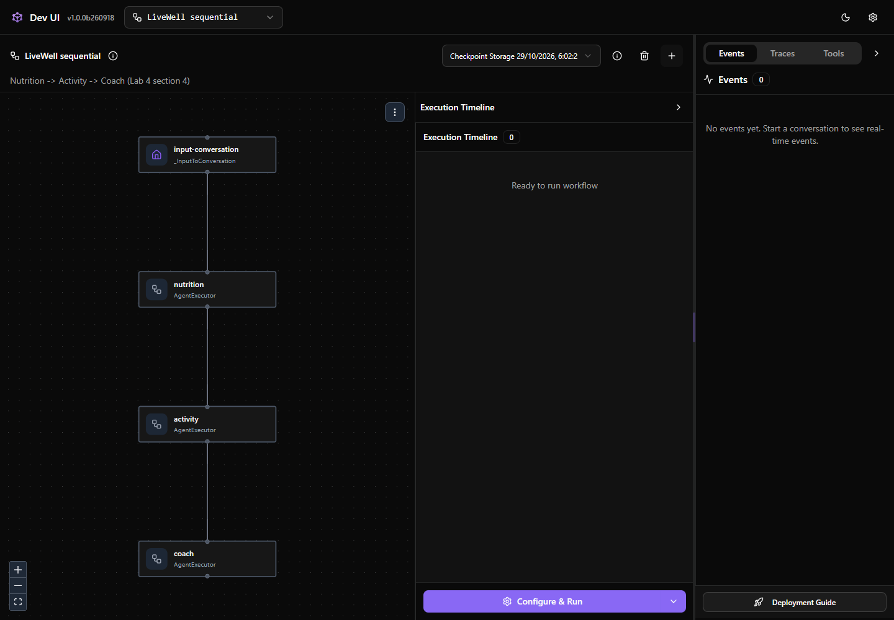
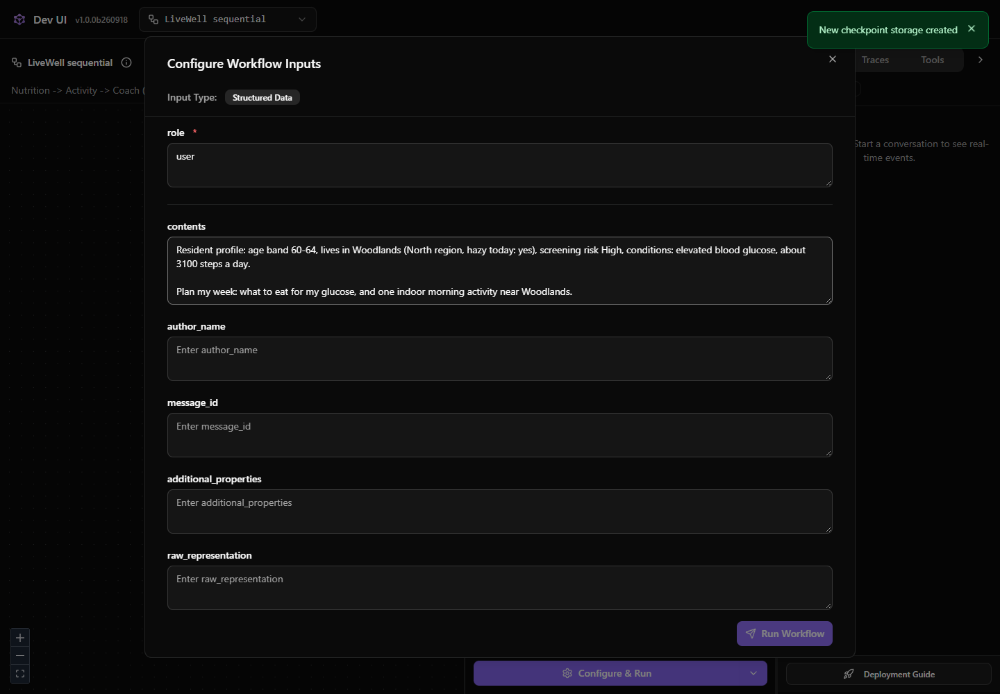
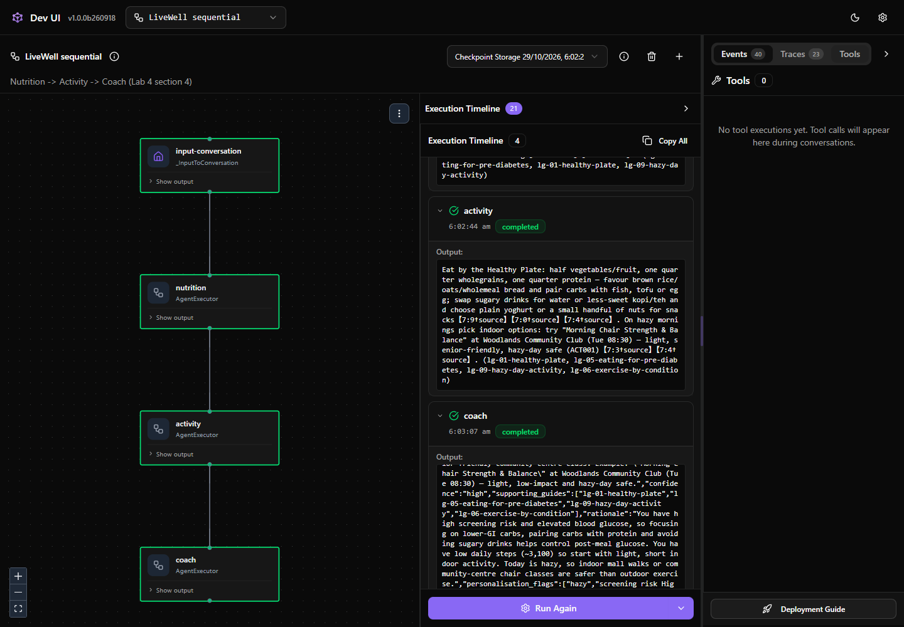
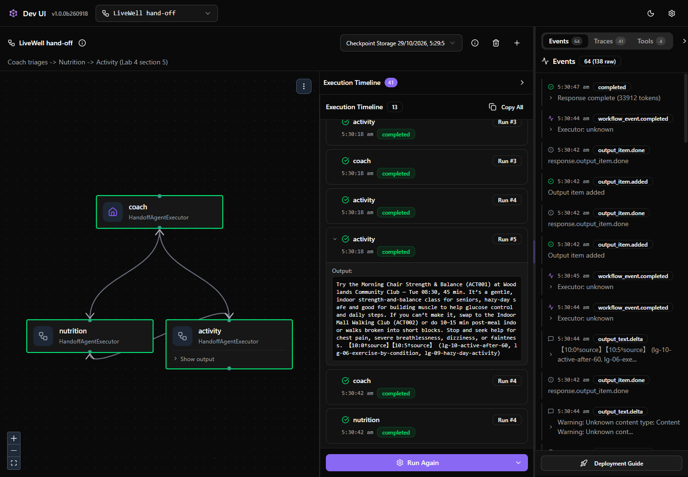
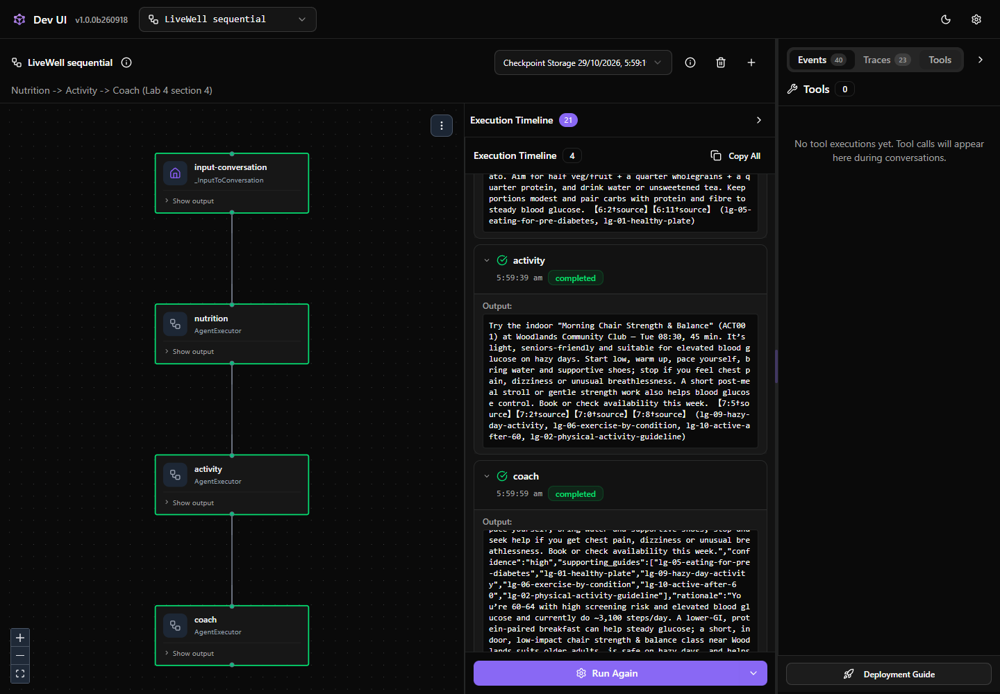
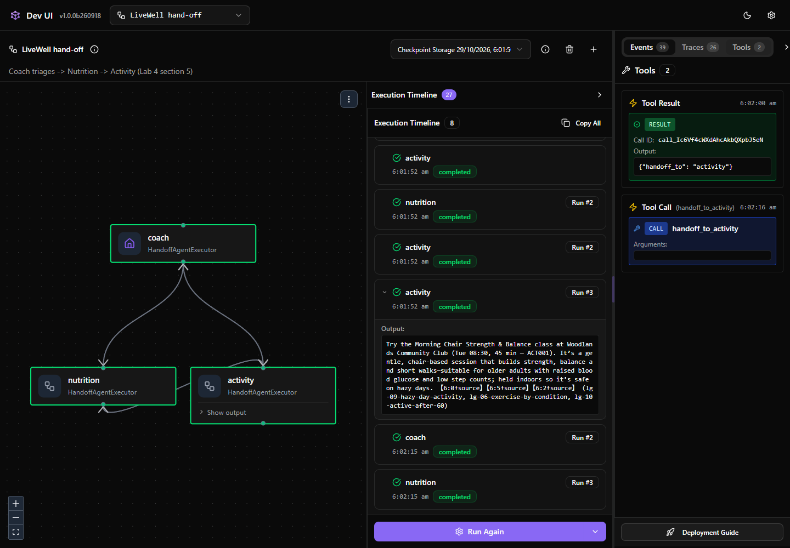

# Lab 4 · Multi-agent & Hosted deploy

**25 min · Level L200 · Patterns #3 Workflow Orchestration · #9 Collaboration Between Specialists · #10 Governance & Safety**

> **Stay on your chosen track; do not switch midway.**
> **Stuck?** Go to [Checkpoint](#checkpoint) and expand **Expected output (open after you have tried it)**. Use the examples and ask for help rather than retry repeatedly.

**Your path:** [Navigator](#navigator) · [Builder](#builder) · [Checkpoint](#checkpoint) · [Troubleshooting](#troubleshooting)

## Shared objective

> Choose between one agent, sequential and hand-off workflows; use execution evidence to explain the route

## Foundry features covered

Microsoft Agent Framework · sequential versus hand-off orchestration · outputs and tool-call evidence · DevUI (**pre-release development sample**).

## Story chapter

Rahim needs food advice and an indoor activity. Compare two ways to coordinate Nutrition and Activity specialists—not prove that every question needs multiple agents.

## 🟢 Navigator

<a id="navigator"></a>

**No installation, deployment or token entry.** Use the supplied private workshop link to the prepared team.
Your earlier portal agent is unchanged; this exercise does not require the Builder section.

### 1. Open the prepared workflow

Click **Lab 4 private launch link (no token entry)** in the private workshop message. **LiveWell sequential** opens automatically. Do not forward the link; it expires at the supplied time.



The graph shows possible structure, not proof of execution. DevUI helps connect a final answer to **who ran, what they returned and which hand-off tools were called**.

| Approach | Use when… |
|---|---|
| **One agent with tools** | One instruction set handles the task. Start here. |
| **Sequential** | Every request needs known stages in a fixed order. |
| **Hand-off** | Requests need different specialists, selected from permitted routes. |

### 2. Run the fixed-order team

Select **+ → Configure & Run**. Enter `user` in **role** and paste this complete `lab4_week_plan_handoff` request into **contents**, then **Run Workflow**:



<!-- copy:request lab4_week_plan_handoff -->
```text
Resident profile: age band 60-64, lives in Woodlands (North region, hazy today: yes), screening risk High, conditions: elevated blood glucose, about 3100 steps a day.

Plan my week: what to eat for my glucose, and one indoor morning activity near Woodlands.
```
<!-- /copy -->

In **Execution Timeline**, open each agent's **Output**. Expect **Nutrition → Activity → Coach**, ending with the Coach's evidence JSON.



**Explain:** which earlier contributions did the Coach use?

### 3. Run the hand-off team

Select **LiveWell hand-off**, then **+** for a fresh session. Use **Configure & Run**, `user`, and the same complete request from step 2.

Inspect **Tools** for `handoff_to_nutrition`, then `handoff_to_activity`. Each call has a result, so four entries can mean **two hand-offs**, not four.



This example ends with **Activity's answer**, not Coach-merged JSON. Nutrition's contribution is earlier in the timeline.

**Explain:** the developer permits routes; the model selects them by calling tools. Point to the call that transferred control.

### 4. Compare a narrower request

Use a fresh session in each team with `lab4_activity_only`:

<!-- copy:request lab4_activity_only -->
```text
Resident profile: age band 60-64, lives in Woodlands (North region, hazy today: yes), screening risk High, conditions: elevated blood glucose, about 3100 steps a day.

Suggest one indoor morning activity near Woodlands for me this week.
```
<!-- /copy -->

Sequential still visits all stages. Hand-off should go **Coach → Activity**, without Nutrition. Record the route you actually see.





Green boxes and repeated timeline rows do not prove another model call. In the hand-off capture, inspect the **actual tool name** and Activity's output; there is no Nutrition hand-off.

Which approach avoids unnecessary work? Compare routes, not promised speed: the hand-off team also omits the final Coach merge.

## 🔵 Builder

<a id="builder"></a>

**Before starting:** use your Builder environment and `.env` from Lab 0. No Navigator agent or DevUI login is required.

```bash
python content/assets/lab4_multiagent.py --verbose
```

Or run [`lab4_multiagent.py`](../assets/lab4_multiagent.py) as `# %%` cells.

1. Inspect sections 1–3: the synthetic profile, model client, specialist instructions and tools.
2. Read the sequential trace **Nutrition → Activity → Coach** and the Coach's merged evidence JSON.
3. Read the hand-off trace **Coach → Nutrition → Activity**. Locate `handoff_to_nutrition` and `handoff_to_activity`; inspect both contributions and the final Activity answer.
4. Compare the `SequentialBuilder` and `HandoffBuilder` definitions. Explain when a fixed route is useful, when a permitted hand-off is useful, and when one agent would suffice.

The default script runs the week-plan pair. It creates no Foundry agents, deploys nothing, and does not invoke Fabric or the optional hosted endpoint. Leave `--fabric` and `--hosted` unset.

**Optional further learning:** [Create a hosted agent with Microsoft Foundry Toolkit for VS Code](https://learn.microsoft.com/en-us/azure/foundry/how-to/develop/vs-code-agents-workflow-pro-code). This separate tutorial covers local inspection and deployment; it is **not required to finish this lab**.

## Checkpoint

✅ **Built** an explanation of when one agent, sequential or hand-off is appropriate.

✅ **Did** a workflow comparison and identified actual agent outputs and hand-off calls.

✅ **Learned** that a diagram is not execution evidence and that the final answerer depends on the pattern.

<details>
<summary><strong>Expected output (open after you have tried it)</strong></summary>

| Request | Sequential | Hand-off |
|---|---|---|
| Week plan | Nutrition → Activity → Coach; Coach JSON | Coach → Nutrition → Activity; Activity answer |
| Activity only | All three stages still run | Coach → Activity; no Nutrition hand-off |


Builder prints the week-plan traces, tool names, agent outputs and a `CHECKPOINT`.
These are intended routes, not guaranteed model outcomes; explain the actual run if it differs.

</details>

## Troubleshooting

<details>
<summary><strong>Troubleshooting</strong></summary>

| Problem | Next action |
|---|---|
| Expired link / 401 | Ask for a fresh private launch link. Never paste or retrieve a backend token. |
| Token-entry form appears | Reopen the private link in a fresh tab and report continued failure. |
| Slow first load / busy seats / 429 | Wait for the next group; do not repeatedly start workflows. |
| Other sessions appear | Select **+** for your own; do not open or change someone else's run. |
| Old session blank / history error | Use a fresh session and inspect execution live. Saved-history reopening is unreliable in this pinned DevUI. |
| Red failed node | Open **Show error** and record the message. |
| `knowledge_base_retrieve` exceeds its runtime | A live check encountered a 90-second retrieval timeout. Wait, then try one fresh session; if it repeats, use Expected output and report it rather than keep rerunning. |
| Route differs | Inspect the actual tool call; do not retry indefinitely to match the example. |
| Knowledge/activity tools absent from DevUI's Tools panel | That panel shows local hand-offs, not Foundry-hosted MCP internals. Token counts are not tool-call proof. |

DevUI is a Microsoft open-source development sample, not a production multi-user app. Use only synthetic data.

</details>

## Where next

Return to the [workshop map](../../README.md) and compare the patterns you used.
