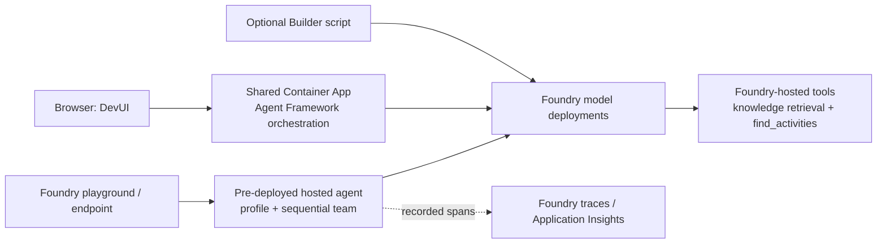

# Lab 4 · Multi-agent & Hosted deploy

**30 min total** · **25 min guided comparison in the 1:15 block + 5 min hosted proof at 5:15** · **Level:** L200; optional Builder detail L300 · **Patterns:** #3 Workflow Orchestration · #9 Collaboration Between Specialists · #10 Governance & Safety

**You are here:** [Lab 0](lab-00.md) → [Lab 1](lab-01.md) → [Lab 2](lab-02.md) → [Lab 3](lab-03.md) → **Lab 4** → [Bridge spotlight](bridge-spotlight.md) · [README](../../README.md)

## Shared objective

> Choose between one agent, sequential and hand-off workflows; use execution evidence to explain the route, then inspect the pre-deployed hosted team

## Foundry features covered

Microsoft Agent Framework orchestration · DevUI execution views (**pre-release development sample**) · Foundry hosted-agent traces, versions and guardrails · optional Fabric IQ specialist (**preview**, facilitator only).

## Story chapter

Rahim asks for food advice and an indoor activity. We compare two ways to coordinate Nutrition and Activity specialists—not prove that his question needs multiple agents. [Chapter 4](../narrative/rahim.md#chapter-4--livewell-goes-live-lab-4--multi-agent--hosted-deploy) ends with the sequential team behind a hosted endpoint.

## 🟢 Navigator

**Already prepared:** one shared LiveWell demo, with sequential and hand-off views of the specialist team. Open the facilitator's private link: **no installation, deployment or token entry**. It starts on **LiveWell sequential**; your Lab 3 coach is unchanged. Follow the facilitator first, then run in groups of no more than eight per workflow. Session listings and model capacity are shared.

### Choose the simplest design that works

| Approach | Use it when… | Trade-off |
| --- | --- | --- |
| **One agent with tools** | One set of instructions handles the task adequately. Start here. | Multiple tools do not require multiple agents. |
| **Sequential** | Every request needs known stages, with later stages using earlier results. | Predictable order, but every stage runs. |
| **Hand-off** | Different requests need different specialists. | The model chooses among routes the developer permits; choices can vary. |

Specialists can share one model: their **instructions and tools** define their roles. Splitting work can improve reuse and ownership, but adds calls, latency and failure points.

### Why use DevUI?

A chat answer hides who did the work. We choose **DevUI** to connect the answer to the route and intermediate outputs; it is not required to build or deploy a workflow.

| View | Your observation task |
| --- | --- |
| **Graph** | Find the agents and connections. A diagram is not proof that every edge ran. |
| **Execution Timeline** | Open each agent's **Output**. Who contributed, and who answered last? |
| **Tools** | Find `handoff_to_…`: these calls transfer control to a specialist. |

**Visibility limit:** this app's Tools panel shows local hand-offs, not the Foundry-hosted `knowledge_base_retrieve` or `find_activities` calls. Use Foundry's server-side traces for those operations where recorded. Large token counts do not prove a tool ran.

### 1. Open the shared workflow

Click **Lab 4 private launch link (no token entry)** from the facilitator's private workshop message. It handles access automatically and opens **LiveWell sequential**. The first load can take 20–30 seconds. **Do not forward or publish this link**; it expires at the time supplied with it.

You can inspect the graph without running a model. **To run:** confirm the selected workflow → **+** for a fresh session → **Configure & Run** → enter `user` in **role** → paste the full prompt in **contents** → **Run Workflow**. Do not open or change another participant's session. Deployment controls are not used.

### 2. Predict → run → explain: fixed order

**Predict:** who should contribute to a food-and-activity plan?

**Run:** select **LiveWell sequential** and paste the profile plus `lab4_week_plan_handoff`:

```text
Resident profile: age band 60-64, lives in Woodlands (North region, hazy today: yes), screening risk High, conditions: elevated blood glucose, about 3100 steps a day.

Plan my week: what to eat for my glucose, and one indoor morning activity near Woodlands.
```

**Observe:** Nutrition → Activity → Coach. Open their outputs; the Coach merges the contributions into evidence JSON with guide ids.

**Explain:** the code fixes the order. Which earlier outputs did the Coach need?

### 3. Predict → run → explain: model-selected hand-off

**Predict:** who should decide which specialist takes the request?

**Run:** select **LiveWell hand-off**, start a fresh session and reuse the full prompt above.

**Observe:** in **Tools**, read calls from bottom to top: `handoff_to_nutrition`, then `handoff_to_activity`. This example ends with **Activity's answer**, not a Coach-merged JSON. Both specialists should contribute.

**Explain:** the developer allows the hand-offs; the model selects them by calling tools. Point to the call that transferred control.

<details>
<summary><strong>Screenshot guide: where to look, and why Tools says “4”</strong></summary>

After opening the private link, the prepared sequential graph is visible without a token form. Select **+**
before your own run; a graph alone does not call a model.


**1 · Graph:** locate the agents, but do not count highlighted boxes as model calls. The hand-off visualisation can show extra edges; the configured permissions and actual calls determine the route.

**2 · Timeline:** expand entries with **Output**. Repeated **Run #2**, **Run #3** entries can record broadcast messages rather than another model invocation. **Traces → OTel Spans** provides the recorded model-call timing and usage.

**3 · Tools:** **4** entries here means **two calls plus two results**, not four hand-offs. `handoff_to_activity` transfers control; it does not search the activities catalogue.

These are captured examples, not a live broadcast of the facilitator's current run.

</details>

### 4. Predict → run → explain: an unnecessary specialist

**Predict:** does an activity-only request need Nutrition?

**Run:** use a fresh session in each team with the profile plus `lab4_activity_only`:

```text
Resident profile: age band 60-64, lives in Woodlands (North region, hazy today: yes), screening risk High, conditions: elevated blood glucose, about 3100 steps a day.

Suggest one indoor morning activity near Woodlands for me this week.
```

**Observe:** sequential still runs Nutrition → Activity → Coach; hand-off should call only `handoff_to_activity`, skipping Nutrition.

**Explain:** which design avoids unnecessary work? Compare the route, not a promised number of seconds. This hand-off also omits the Coach's merge, so it is **not an equal-output speed benchmark**.

### 5. Hosted proof: the same sequential team, a different host

At 5:15, follow the [five-minute portal walkthrough](lab-04-portal.md), or watch the facilitator. The team is **already deployed** as **`livewell-workshop-hosted`**. Inspect its answer and `workflow.run` trace; the facilitator shows the guarded endpoint. No participant deploy or publish step is required.

<details>
<summary><strong>FAQ: DevUI, models, hosting and the Lab 3 connection</strong></summary>

**Is DevUI a Microsoft product or open source?** It is Microsoft's MIT-licensed [Agent Framework sample application](https://learn.microsoft.com/agent-framework/integrations/by-component/ui/devui/), not a production portal or a drag-and-drop workflow designer. Agent Framework runs the orchestration; Foundry supplies the models and hosted tools.

**Are these my Lab 3 agents?** No. The shared Python app instantiates the same specialist roles and instruction blocks. These are not separate model deployments or copies of your portal agent. Your Lab 3 memory and conversation do not carry over; the pasted synthetic profile supplies this run's context.

**How is this different from Lab 3's A2A option?** A2A is a protocol for reaching a specialist agent. Sequential and hand-off are orchestration choices about who runs next. This lab's core uses Agent Framework objects and does not need participants to configure A2A connections.

**How does the private link work?** It grants temporary workshop access and is exchanged for a secure browser session. The backend secret stays on the server; you never paste a token. The container calls Foundry using managed identity. This is separate from the workshop-account sign-in used in the Foundry portal.

**What if it expires?** Ask the facilitator for a fresh link. A normal DevUI address or a bookmark without the private access fragment does not grant first-time access. Anyone with the complete link can use it until expiry, so keep it private. This does not provide per-person authorisation or isolated conversation lists.

**Is this one provisioned Foundry demo agent?** The shared container instantiates the prepared Agent Framework team and its two routing patterns. It is not a generic viewer attached to your own agent, nor a proxy to the separate hosted agent used in step 5. This preserves the graph and hand-off evidence.

**Does every path use the same guardrail?** No. DevUI and local Builder calls use the model deployment's default guardrail. The hosted endpoint and its playground use the hosted agent's attached **`livewell-guardrails`** policy. Separate specialist instructions alone are not a security boundary.

**Must we use DevUI?** No. It is convenient for this shared browser exercise. Developers can use [Agent Inspector](https://learn.microsoft.com/azure/foundry/how-to/develop/vs-code-agent-inspector) with compatible development diagnostics; [Foundry tracing](https://learn.microsoft.com/azure/foundry/observability/how-to/trace-agent-framework) covers instrumented cloud execution. A generic endpoint does not automatically expose a workflow graph.

The Foundry portal **Workflows** item is not used in this workshop.

</details>

<details>
<summary><strong>Optional facilitator extension: Programme-Insights and Fabric IQ (preview)</strong></summary>

This is a **separate specialist demonstration**, not a fourth agent in the two DevUI workflows. Skip it when Fabric is paused or time is short; core Lab 4 does not depend on Fabric.

The facilitator opens the prepared Programme-Insights agent and sends `lab4_q_programmes_disengaged`:

```text
Which programmes have the most disengaged residents enrolled?
```

Look for a Fabric-routed aggregate answer grouped by programme, with no resident-level detail. The computed reference puts **<!--ref:q_programmes_disengaged_enrolled.top_programme-->Healthier SG<!--/ref-->** first (<!--ref:q_programmes_disengaged_enrolled.top_disengaged_enrolled-->82<!--/ref--> disengaged residents enrolled); ±1 rank is accepted. Do not create an agent or resume capacity as part of the participant exercise.

</details>

### Under the hood

<details>
<summary><strong>Code map, routing rules and further reading</strong></summary>

The shared app is [`demos/lab4-devui.py`](../../demos/lab4-devui.py). It creates a fresh workflow for each run; the session list remains shared. The Builder equivalent is [`lab4_multiagent.py`](../assets/lab4_multiagent.py).



| Agent | Responsibility | Tools / output |
| --- | --- | --- |
| Nutrition | Grounded meal advice | `knowledge_base_retrieve`; meal tip and guide ids |
| Activity | Suitable nearby activities | Knowledge retrieval + read-only `find_activities`; activity advice |
| Coach, sequential | Merge earlier contributions | No tools; evidence JSON |
| Coach, hand-off | Select a permitted specialist | `handoff_to_nutrition` or `handoff_to_activity`; triage rather than merge |

**Sequential (script section 4):** `SequentialBuilder` fixes the order and passes earlier messages to the next agent. `output_from="all"` exposes each answer.

**Hand-off (section 5):** `HandoffBuilder` defines allowed targets. Nutrition's first turn hides hand-off tools so it answers before passing control to Activity; an extra autonomous turn enables that transfer. The run stops when Activity answers. This is a deliberately constrained teaching example, not unrestricted autonomous planning.

**Hosted (section 7):** [`hosted-agent-example/main.py`](../assets/hosted-agent-example/main.py) prepends a `ResidentProfile` step and serves the sequential team through the Responses protocol. Hosting is a deployment choice, not a third orchestration pattern. Provisioning instructions remain in the [facilitator README](../assets/hosted-agent-example/README.md).

Further reading: [sequential](https://learn.microsoft.com/agent-framework/workflows/orchestrations/sequential) · [hand-off](https://learn.microsoft.com/agent-framework/workflows/orchestrations/handoff) · [Agent Framework overview](https://learn.microsoft.com/agent-framework/overview/).

</details>

## 🔵 Builder

The shared-browser exercise above is sufficient. Expand this only to inspect or run the Python implementation.

<details>
<summary><strong>Optional: run the canonical script or inspect its cells</strong></summary>

```bash
python content/assets/lab4_multiagent.py
```

Use the existing [Builder setup](../../README.md#-builder-setup); initials and endpoint come from `content/assets/.env`. Alternatively, open the same file in VS Code or Codespaces and run its `# %%` cells. These are live model calls, not an offline replay.

| Sections | What to inspect |
| --- | --- |
| 1–3 | Profile summary, model client, tools and specialist instructions |
| 4 | Fixed-order workflow; Coach merges evidence JSON |
| 5 | Allowed hand-offs, first-turn rule and stop condition |
| 7–8 | Call the already-deployed hosted team and print the checkpoint |

The default run creates no Foundry agents and skips section 6 even when `FABRIC_BRIDGE=true`. **`--fabric` is facilitator-only**, requires `FABRIC_BRIDGE=true`, and creates/updates Programme-Insights; it is not needed for this lab's core.

Use `--verbose` for each agent's answer, `--no-handoff` to skip hand-off, or `--cleanup` to remove only your own `livewell-<INITIALS>-*` agents. Protected demo/workshop agents are never deleted.

The script runs the week-plan comparison; the activity-only comparison is available in DevUI. Local visualisation with `python demos/lab4-devui.py` is optional and needs `requirements-demos.txt`. Even its `--mermaid` export resolves Foundry connections first; it is not an offline command.

</details>

## Checkpoint

✅ **Built** an explanation of when to keep one agent and when to use a fixed or model-selected route.

✅ **Did** a run or followed the facilitator, identified a hand-off call and compared the final answerers.

✅ **Learned** to distinguish a workflow diagram from execution evidence, and hosting from orchestration.

There is nothing to submit. Explain your choice to a neighbour, then expand the comparison.

<details>
<summary><strong>Expected output and discussion answers</strong></summary>

| Example | Expected route | Final answer |
| --- | --- | --- |
| Week plan, sequential | Nutrition → Activity → Coach | Coach's evidence JSON with guide ids |
| Week plan, hand-off | Coach → Nutrition → Activity | Activity's answer; Nutrition's contribution is earlier in the timeline |
| Activity only, sequential | Nutrition → Activity → Coach | Coach's evidence JSON; Nutrition was unnecessary |
| Activity only, hand-off | Coach → Activity | Activity's answer; no Nutrition hand-off |

These are the intended routes, not guarantees about every model response. If a run differs, identify the actual call and discuss it rather than treating elapsed time as a pass/fail test.

**When is one agent enough?** When one instruction/tool set handles the task reliably. This example does not prove multiple agents improve answer quality.

**What proves a hand-off?** A recorded `handoff_to_…` call and its result—not an edge or green node alone.

**What changes after hosting?** The execution location, endpoint, identity and policy attachment. The hosted sequential trace adds `resident_profile` before `nutrition`, `activity` and `coach`; it does not introduce another routing pattern.

</details>

## Troubleshooting

<details>
<summary><strong>Access, busy runs, unexpected routes and missing traces</strong></summary>

| Symptom | What to do |
| --- | --- |
| Access expired / 401 | Ask for a fresh **private launch link** and reopen it. Do not paste a token, use a TAP or retrieve Azure secrets. |
| “Open the complete private link” | Open the full link supplied by the facilitator; a copied base address is not sufficient. |
| A token form appears | You may have an old page or revision open. Reopen the private link in a fresh tab and tell the facilitator if it persists. |
| Slow first load | Allow 20–30 seconds for startup; ask the facilitator if it stays unavailable. |
| “All N seats … are busy” / 429 | Wait and run in the next group, or watch the facilitator. Do not repeatedly start more runs. |
| Other people's sessions appear | Expected on this shared development app. Select **+**; use only the supplied synthetic data. |
| Workflow not found / old run missing | A restart loses in-memory sessions. Reopen the shared URL and start a fresh session. |
| Old session is blank or reports a history error | Select **+** and inspect a fresh run while it executes. This pinned DevUI can fail to reopen saved workflow messages; it is not a permanent trace archive. |
| Red failed node | Select **Show error**; give the facilitator the message. They can inspect the failed span in **Traces → OTel Spans**. |
| Unexpected hand-off / Coach asks a question | Record the route you saw. Reply with the requested food/activity need if prompted; ask the facilitator rather than retrying indefinitely. |
| Hosted agent unavailable or trace missing | Use the screenshots in the portal walkthrough or watch the facilitator. Do not deploy it yourself. |
| Fabric paused | Skip Programme-Insights. Both DevUI teams and the hosted sequential team work without Fabric. |

Facilitators: DevUI is a development sample with shared, in-memory sessions, not a multi-user production application. Endpoint, role and guardrail recovery procedures are in the [hosted-agent README](../assets/hosted-agent-example/README.md).

</details>

## Where next

[Bridge spotlight · Two IQs, one agent](bridge-spotlight.md), then close on the ten patterns in [README](../../README.md).
